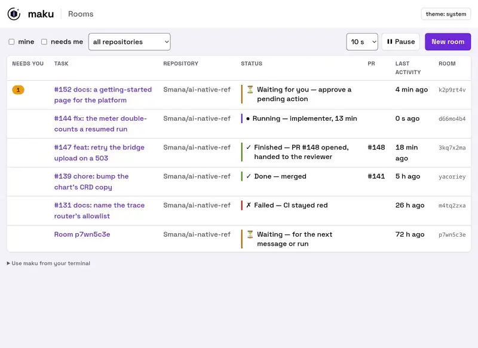

+++
author = "Smaine Kahlouch"
title = "`Agent Factory`: agents and humans, one crew"
date = "2026-11-05"
slug = "agent-factory-1-overview"
summary = "From a plain GitHub issue to a reviewed, secure and traceable pull request: one label opens an isolated workspace where agents and humans take turns on the work. Episode one: the problem, and the big picture of the solution."
featured = true
draft = false
codeMaxLines = 30
usePageBundles = true
toc = true
series = ["Agentic AI"]
tags = ["ai", "kubernetes", "security", "platform-engineering"]
thumbnail = "thumbnail.jpg"
+++

{}
Previously in this series: [the fundamentals of coding agents](/post/series/agentic_ai/ai-coding-agent/), [my day-to-day Claude Code workflows](/post/series/agentic_ai/ai-coding-tips/) and [a self-hosted LLM stack](/post/series/agentic_ai/llm-self-hosted-stack/).

Now it's time to scale up: a **shared** environment where a team works alongside agents and can trust what they ship. This post kicks off a series about that **Agent Factory**, each article digging into one of its building blocks.
{}

For a few months now, I've barely written a line of code without an agent, and I see the same shift all around me: we write less code and spend more time **steering** agents.

The catch is that what works on my laptop doesn't carry over to a team. Everyone brings their own instructions and tools, and practices quickly drift from one machine to the next. In an organization, an effective coding agent isn't enough: you need to guarantee the quality and security of what **actually** reaches production, no matter who started the agent.

Meanwhile, agents keep getting more reliable, to the point where handing them some changes end to end, from the issue all the way to the merge, starts to look reasonable. That still leaves two questions: what should earn them that trust, and how do you measure it? That's what **software factories** are all about.

This series describes the **Agent Factory**, my attempt at answering those questions: a pipeline that takes an issue to a merged pull request, built with cloud native open source tools. It runs on [`cloud-native-ref`](https://cnref.ogenki.io/), my reference platform, which already covered most of the groundwork (Crossplane, Cilium, ZITADEL, OpenBao, observability). On top of it, I added a layer dedicated to agents, plus the glue that keeps the whole machine running 😉. Everything is documented at **[airef.ogenki.io](https://airef.ogenki.io/)**, the starting point for everything this series covers.

This first post frames the problem and gives a high-level view of the solution. The next ones will dig into each building block, starting with Maku. It's all open source, and there's no need to take the whole package: grab the ideas that make sense to you and adapt them to your own context. 🚀

## 🎯 Goals

* 🏭 Understand what a **software factory** is, and where this one sits on the autonomy scale
* 🧩 See what the factory **concretely brings**, for developers and for the organization
* 🗺️ Get the big picture: **three repositories, three layers**, and the open source building blocks behind them
* 🔄 Follow a task **end to end**, from issue to merged pull request

## 🏭 What is a software factory?

A **software factory** is a pipeline that turns a queue of work (issues, a backlog) into shipped changes, with agents at every step. The best-known examples come from large engineering organizations:

* [Stripe's Minions](https://www.infoq.com/news/2026/03/stripe-autonomous-coding-agents/), behind more than **1,300 PRs a week**;
* [Honk at Spotify](https://engineering.atspotify.com/2025/11/spotifys-background-coding-agent-part-1), with more than **1,500 merged PRs** to its name.

Look past the numbers, and any factory comes down to three ideas:

* 🔁 **The loop**: each agent observes, acts and checks its work, until the task is done.
* 🧰 **The harness**: everything around the loop. Where the agent runs, which tools and permissions it gets, and what "done" means.
* 🚦 **The gate**: a final checkpoint that decides what reaches production.

### 🪜 Where do humans fit in?

What really sets factories apart is how much room they leave for humans. Dan Shapiro proposed [a scale](https://www.danshapiro.com/blog/2026/01/the-five-levels-from-spicy-autocomplete-to-the-software-factory/) modelled on the levels of driving automation: the higher you climb, the further the human steps back.

| Level | Your role | Example |
|---|---|---|
| **0 · Spicy autocomplete** | You write the code, the AI suggests what comes next | Your editor finishes the loop you just started typing |
| **1 · One-off tasks** | You hand off small, well-scoped tasks; the rest of your work stays the same | "Write a unit test for this function" |
| **2 · Pair programming** | You work with the AI as you would with a junior colleague, and let it handle the repetitive bits | A Claude Code session where you approve every edit |
| **3 · The manager** | The agent writes most of the code; you **review every diff** | Several agents running in parallel, and you hop between them to review |
| **4 · The spec writer** | You write the spec, review the plan, then come back later to check that the tests pass | An issue written in the evening, a PR waiting for review the next morning |
| **5 · The *dark factory*** | **Nobody reads the code anymore**: specs go in, software comes out | At [StrongDM](https://simonwillison.net/2026/Feb/7/software-factory/), "Code must not be reviewed by humans", and the test scenarios live outside the repository so the agents can't see them |


 

The dark factory isn't where I'm heading. Once nobody reads the code, one question is hard to dodge: **who still understands the system?** Knowledge erodes, and the day something breaks, nobody knows where to look. As with [RunLore](/post/series/observability/runlore/), I'd rather let agents do the work while **humans keep the final say on what matters most**: what goes to production. Steering the boat rather than watching it drift. ⛵

So this factory sits at **level 4**: I write the issue, the agents scope, implement, test and review each other's work, and **approving the commit is what merges it**. **Level 5** is reserved for changes that meet **conditions we set ourselves**, written as *gates* versioned in the repository, with a circuit breaker that hands control back to humans at the first incident.

## 🧩 From laptop to team: what's in it for me?

On my laptop, trust is barely an issue: I start the agent, watch it work, review, push. **I am the guardrail.** But once the agent works for a team, on a shared cluster, with nobody watching the screen, that guardrail has to be built into the architecture. An autonomous agent is **unreviewed code running with privileges**.

What the factory gives you in return depends on whether you're the one at the keyboard, or the one accountable for what ships.

### 👩‍💻 For developers

* ⏱️ **Hand it off and move on.** A well-written issue is all it takes: nobody has to sit and watch, and the PR you get back has already been reviewed by an agent. On October 29th, a RunLore alert fired at 6:28 am; the PR fixing the rule was open by 6:33 and merged, with my approval, at 6:47.

* 🚪 **Start a task from wherever you are.** A label on the issue, a Slack message, the CLI, or straight from your own coding agent. No context switching.

* 🧰 **Nothing to install, nothing to maintain.** The harness, the tools, access to the models and to GitHub: the platform provides it all. No keys on your laptop, no config to keep up to date, and the same tooling as the rest of the team.

* 🎛️ **Stay in control without reading everything.** The room, the task's shared log, shows what the agent is doing in real time; you can nudge it along the way or stop it with a label. At the end, only one action is left to you: approve the commit, and it's merged.

* 📝 **A report that writes itself.** Budget, steps, a link to the room, who merged: it all lands on the issue as it happens. No more "wait, what was I doing here?" when you come back to it.

### 🏢 For the organization

Once code leaves the developer's laptop, new questions come up, and the factory has to answer them with **guarantees**:

| Question | On my laptop | In the factory |
|---|---|---|
| 🪪 **Who's acting?** | Me, with my own tokens | Every agent run gets **its own short-lived identity**, and its spend is billed to whoever started it |
| 🌐 **What can it reach?** | The entire Internet | Only **explicitly listed** destinations; everything else doesn't even resolve |
| 🚦 **Who decides to merge?** | Me | **Rules versioned in the repository**, plus a human whenever those rules aren't enough |
| 📓 **Where's the evidence?** | My terminal, then nothing | A **shared, tamper-proof log** for each task, with every action attributed. Audits, post-mortems and onboarding a new teammate all start there, even six months later |

On top of those guarantees, you get what you'd expect from any shared platform:

* 🧱 **Quality and security no longer depend on whose machine it is.** Junior or senior, well-configured laptop or not: everyone goes through the same agent roles, the same reviewer and the same gate. The rules get better in one place, for everyone.

* 💸 **A cost you know upfront, with a ceiling.** The budget (model, tokens, duration) is shown at startup. A queue caps how many runs execute at once, and a circuit breaker shuts a lane down as soon as it goes off the rails. The October 29th alert fix cost 490k tokens, and I knew that before merging.

* 📈 **Autonomy that grows at your own pace, through written rules.** You start at level 4, where a human approves everything. Once a family of changes has proven itself, a versioned rule grants it auto-merge, and revokes it at the first incident. The policy gets reviewed and debated like code.

* 🤝 **One front door for anything that wants to change the repository.** Humans, but other agents too: an alert handled by RunLore can turn into an issue, then a task, then a PR, without anyone typing a single line, and under the same controls.

* 🔓 **No vendor lock-in.** Every building block is open source and swappable, the model is a single line of config, and humans still understand the system because they review what ships.

To be completely honest, I've tested this a lot (37 agent PRs merged since late September), but mostly on fairly simple changes, a handful of files each time. That's exactly where a factory shines: recurring, well-scoped changes. For a big feature spanning many tasks, the laptop is probably still faster. I'm curious to see how far this can go.

## 🗺️ The big picture

The Agent Factory is built on three repositories ([`cloud-native-ref`](https://github.com/Smana/cloud-native-ref), [`ai-native-ref`](https://github.com/Smana/ai-native-ref) and [`maku`](https://github.com/Smana/maku)), each with a clear scope. The AI platform, which carries everything agent-specific, has its own documentation: **[airef.ogenki.io](https://airef.ogenki.io/)**.


 

The AI platform is delivered to the Kubernetes cluster as a **signed OCI artifact**, disabled by default: nothing turns on without an explicit decision. The cluster, for its part, commits in a written *contract* to what it provides (namespaces, identity, secrets, gVisor nodes, observability).

{}
The **Agent Factory** is a set of open source components that, put together, turn an issue into a reviewed pull request.

**[Maku](https://github.com/Smana/maku)** (幕, "the curtain" in Japanese) is one of them: the controller that orchestrates all the others, built around a single promise: *"Run coding agents on your Kubernetes cluster without trusting them."*

{}

Apart from Maku, every building block is an existing open source project, used for what it does best:

| Building block | What it does in the factory |
|---|---|
| [OpenHands](https://github.com/OpenHands/OpenHands) | The agent itself: the loop and its developer tools |
| [gVisor](https://gvisor.dev/) and [`agent-sandbox`](https://agent-sandbox.sigs.k8s.io/) | One sandbox per run, with a user-space kernel |
| [Crossplane](https://www.crossplane.io/) | Builds everything a run needs from a single resource |
| [Cilium](https://cilium.io/) | A network closed by default, opened one hostname at a time |
| [agentgateway](https://agentgateway.dev/) | The single way out: identity, access to models and tools, budgets |
| [octo-sts](https://github.com/octo-sts/app) | One-hour GitHub tokens, scoped to a single repository and role |
| [policy-bot](https://github.com/palantir/policy-bot) | The merge policy, versioned in the repository |
| [Kueue](https://kueue.sigs.k8s.io/) | A capped admission queue, so a runaway factory can't swamp the cluster |
| [ZITADEL](https://zitadel.com/), [OpenBao](https://openbao.org/), [Flux](https://fluxcd.io/), [VictoriaMetrics](https://victoriametrics.com/) | Human identity, secrets, GitOps and observability, all provided by the host cluster |

## 🔄 A task from start to finish

Here's the journey of a task, at a high level:


 

1. **A maintainer** adds the `factory/ready` label to an issue. The same label added by anyone else does nothing. A task can also be started from Slack, from the `maku` CLI, or right from your coding agent.

2. **Maku** creates a task and a **room**, the task's shared log. It sets a budget (model, tokens, maximum duration), then starts the agents.

3. **Each agent** runs in its own sandbox, under its own identity. Every call it makes (model, tool, GitHub) goes through the **agent gateway**.

4. **The agents take turns**: one scopes the task, another writes the change and opens the PR, a judge checks that the job is done, and a reviewer goes over it with fresh eyes.

5. **The merge gate decides**: the rare changes that have earned it merge without a human; for everything else, one action is left to you, and **approving the commit is what merges it**.

## 💭 Final thoughts

For a project that's only a few weeks old, the early results are impressive! Granted, I was starting from a cloud native foundation that had already proven itself 😉. Until now, I'd mostly focused on building an efficient local setup with Claude Code or OpenCode, and on keeping up with the breakneck pace of new models. Needs at work pushed me to look more closely at the organizational side: **handing out autonomy and power without losing control**.

This software factory started as a playground for exploring all sorts of topics, but I got hooked, and it has grown into something I take seriously. The next step, already on the [roadmap](https://airef.ogenki.io/docs/status/), says a lot about where it's going: it's called **"anyone can run it"**, and it's quite a challenge. More on that in upcoming posts.

The next post is all about **Maku**, the layer that orchestrates this whole crew. Here's a sneak peek:

<figure style="text-align:center;">
  
  <figcaption><small><a href="https://blog.ogenki.io/maku/">Open the interactive demo ↗</a></small></figcaption>
</figure>

## 🔖 References

### Repositories, docs and demo

* [`ai-native-ref`](https://github.com/Smana/ai-native-ref): the AI platform · [documentation](https://airef.ogenki.io) · [status and roadmap](https://airef.ogenki.io/docs/status/)
* [`maku`](https://github.com/Smana/maku): the controller · [public demo of a room](https://blog.ogenki.io/maku/)
* [`cloud-native-ref`](https://github.com/Smana/cloud-native-ref): the host cluster · [documentation](https://cnref.ogenki.io)

### Software factories

* [Addy Osmani: Software Factories, Light and Dark](https://addyosmani.com/blog/software-factories/)
* [InfoQ: Stripe's Minions, autonomous coding agents](https://www.infoq.com/news/2026/03/stripe-autonomous-coding-agents/)
* [Spotify Engineering: 1,500+ PRs Later, Honk Part 1](https://engineering.atspotify.com/2025/11/spotifys-background-coding-agent-part-1)
* [Dan Shapiro: The five levels, from spicy autocomplete to the software factory](https://www.danshapiro.com/blog/2026/01/the-five-levels-from-spicy-autocomplete-to-the-software-factory/)
* [Simon Willison: StrongDM's software factory](https://simonwillison.net/2026/Feb/7/software-factory/)
* [Agent Baseline: The Secure Software Factory, reference architecture](https://agentbaseline.org/software-factory.pdf)
* [awesome-software-factories](https://github.com/varun1505/awesome-software-factories): a regularly updated map of the landscape
