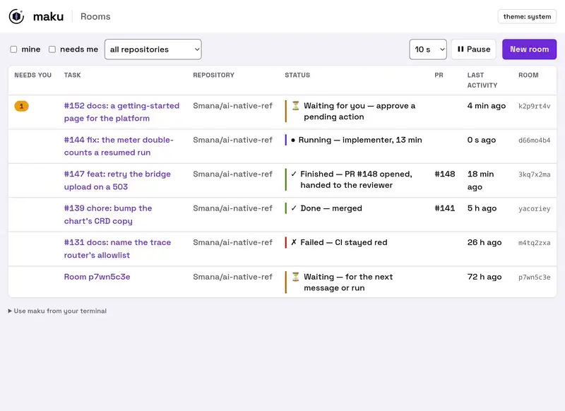

+++
author = "Smaine Kahlouch"
title = "Agent Factory : agents et humains dans la même équipe"
date = "2026-11-04"
summary = "Gagner en autonomie et mieux collaborer à partir d'une simple issue GitHub : un label suffit à ouvrir un espace de travail cloisonné où agents et humains se relaient jusqu'à une PR relue, sécurisée et traçable. Premier épisode : le problème, et la solution vue d'ensemble."
featured = true
draft = true
codeMaxLines = 30
usePageBundles = true
toc = true
series = ["Agentic AI"]
tags = ["ai", "kubernetes", "security", "platform-engineering"]
thumbnail = "thumbnail.png"
+++

{}
Dans les épisodes précédents : [les fondamentaux des coding agents](/fr/post/series/agentic_ai/ai-coding-agent/), [mes workflows Claude Code au quotidien](/fr/post/series/agentic_ai/ai-coding-tips/) et [une stack LLM self-hosted](/fr/post/series/agentic_ai/llm-self-hosted-stack/). Jusqu'ici, l'agent tournait **sur mon laptop**, avec mon propre **harnais** et moi pour seul relecteur. Il est temps de changer d'échelle : un environnement **partagé**, où l'équipe travaille avec les agents et peut faire confiance à ce qu'ils livrent. Cet article ouvre une série consacrée à cette **Agent Factory**, dont chaque article approfondira une brique.
{}

Depuis quelques mois, je ne code presque plus sans agent, et je constate la même évolution autour de moi : on écrit moins de code, on pilote davantage d'agents.

Seulement, ce qui fonctionne sur mon laptop ne se transpose pas tel quel à une équipe. Chacun arrive avec ses instructions, ses outils et ses permissions, et les pratiques divergent vite d'un poste à l'autre. Dans une organisation, il ne suffit pas que mon agent soit efficace : il faut pouvoir garantir la qualité et la sécurité de ce qui part **réellement** en production, quelle que soit la personne qui a lancé l'agent.

En parallèle, les agents gagnent en fiabilité, au point qu'on peut envisager de leur confier certains changements de bout en bout, de l'issue jusqu'au merge. Encore faut-il savoir sur quels critères leur faire confiance, et pouvoir le mesurer. C'est tout l'enjeu des **software factories**.

Cette série décrit l'**Agent Factory**, ma tentative de réponse à ces questions : une chaîne qui va de l'issue à la PR mergée, construite avec des outils open source cloud native. Elle s'appuie sur [`cloud-native-ref`](https://github.com/Smana/cloud-native-ref), ma plateforme de référence, qui fournissait déjà une bonne partie du socle (Crossplane, Cilium, ZITADEL, OpenBao, l'observabilité). J'y ai ajouté une couche dédiée aux agents et la glue nécessaire pour faire tourner la machinerie 😉.

Ce premier article pose le problème et présente la solution dans ses grandes lignes. Les suivants entreront dans chaque brique, à commencer par Maku. Toutes sont open source, et rien n'oblige à tout reprendre : piochez les idées qui vous parlent, adaptez-les à votre contexte et faites-en profiter votre équipe. 🚀

## 🎯 Objectifs de cet article

* 🏭 Comprendre ce qu'on appelle une **software factory**, et où se situe celle-ci sur l'échelle de l'autonomie
* 🧩 Voir ce qui change quand un agent quitte le laptop pour travailler **pour une équipe**
* 🗺️ Découvrir l'architecture d'ensemble : **trois dépôts, trois couches**, et les briques open source qui les composent
* 🔄 Suivre une tâche **de bout en bout**, de l'issue à la PR mergée
* 🧭 Découvrir ce que la suite de la série va approfondir

## 🏭 Software factory : de quoi parle-t-on ?

On entend de plus en plus parler de **software factory**. Les deux exemples les plus cités viennent de grandes équipes d'ingénierie : les [Minions de Stripe](https://www.infoq.com/news/2026/03/stripe-autonomous-coding-agents/), qui produisent plus de 1 300 PR par semaine, et [Honk, chez Spotify](https://engineering.atspotify.com/2025/11/spotifys-background-coding-agent-part-1), à l'origine de plus de 1 500 PR mergées.

Concrètement, une software factory est une chaîne qui transforme une file de travail (des issues, un backlog) en changements livrés, avec des agents à chaque poste. Chaque agent travaille en **boucle** : il observe, agit et vérifie, jusqu'à ce que la tâche soit terminée. Autour de cette boucle, un **harnais** (*harness*) fixe le cadre : où l'agent s'exécute, avec quels outils et quelles permissions, et ce que « terminé » veut dire. Enfin, avant la production, un **gate de revue** décide de ce qui passe. C'est cette chaîne que nous allons détailler, brique par brique, au fil de la série.

Toutes les factories ne laissent pas la même place à l'humain, et c'est ce qui les distingue le plus. Pour les situer, Dan Shapiro a proposé [une échelle](https://www.danshapiro.com/blog/2026/01/the-five-levels-from-spicy-autocomplete-to-the-software-factory/) calquée sur les niveaux de la conduite autonome. Plus on monte, plus l'humain prend du recul :

* **Niveau 0, l'autocomplétion améliorée** : vous écrivez le code, l'IA suggère la suite. *Exemple : l'éditeur complète la boucle que vous venez de commencer.*
* **Niveau 1, les tâches ponctuelles** : vous confiez à l'IA des tâches précises et bornées, le reste du travail ne change pas. *Exemple : « écris un test unitaire pour cette fonction ».*
* **Niveau 2, le binôme** : vous travaillez avec l'IA comme avec un collègue junior, à qui vous laissez le travail répétitif. *Exemple : une session Claude Code où vous validez chaque modification.*
* **Niveau 3, le manager** : l'agent écrit l'essentiel du code, et vous **relisez chaque diff**. *Exemple : plusieurs agents travaillent en parallèle, et vous passez de l'un à l'autre pour relire.*
* **Niveau 4, le rédacteur de specs** : vous écrivez la spécification, vous relisez le plan, puis vous revenez plus tard vérifier que les tests passent. *Exemple : une issue rédigée le soir, une PR à relire le lendemain matin.*
* **Niveau 5, la *dark factory*** : **plus personne ne lit le code**, des specs entrent et du logiciel sort. *Exemple : chez [StrongDM](https://simonwillison.net/2026/Feb/7/software-factory/), « Code must not be reviewed by humans », et les scénarios de test sont tenus hors du dépôt pour que les agents ne puissent pas les voir.*

La dark factory n'est pas la direction que je prends. Quand plus personne ne lit le code, une question devient inévitable : **qui comprend encore le système ?** La connaissance se dilue, et le jour où quelque chose casse, plus personne ne sait où regarder. Mon approche rejoint celle que j'ai suivie avec [RunLore](/fr/post/series/observability/runlore/) : les agents font le travail, mais **l'humain garde la main sur les décisions déterminantes**, comme ce qui part en production, ce qui devient public ou ce qui coûte. C'est ce qui permet de conserver la connaissance du système, et de continuer à diriger le bateau plutôt que de le regarder dériver.


</br>

{}
**Au niveau 4 pour presque tout, au niveau 5 pour une seule voie.** J'écris l'issue, les agents cadrent, implémentent, testent et se relisent entre eux, et **mon approbation du commit vaut merge**. Une seule famille de changements se merge sans moi : les corrections de liens dans la documentation, au plus une par jour, avec un disjoncteur qui la renvoie en revue humaine au premier incident. Et cette autonomie ne s'accorde qu'avec des critères explicites : savoir **exactement** ce qui doit être vrai avant qu'une machine merge quoi que ce soit.
{}

## 🧩 Du laptop à l'équipe : ce qui change

Sur mon laptop, la question de la confiance ne se pose presque pas : je lance l'agent, je le regarde travailler, je relis, je pousse. **Je suis le garde-fou.** Dès que l'agent travaille pour une équipe, sur un cluster partagé et sans personne devant l'écran, ce garde-fou doit passer dans l'architecture. Un agent autonome, c'est du **code non relu qui s'exécute avec des droits**.

Concrètement, quatre questions changent de nature :

| Question | Sur mon laptop | Dans un environnement partagé |
|---|---|---|
| 🪪 **Qui agit ?** | Moi, avec mes propres tokens | Chaque exécution d'agent a **sa propre identité**, courte, et ses dépenses sont imputées à la personne qui l'a lancée |
| 🌐 **Que peut-il joindre ?** | Tout Internet | Uniquement les destinations **nommées** ; le reste ne résout même pas |
| 🚦 **Qui décide du merge ?** | Moi | Des **règles versionnées dans le dépôt**, et un humain dès qu'elles ne suffisent pas |
| 📓 **Où est la preuve ?** | Mon terminal, puis plus rien | Un **journal partagé et inaltérable** par tâche, où chaque action est attribuée |

À ces quatre questions s'ajoute celle de l'**homogénéité** : quand toute l'équipe passe par le même circuit (les mêmes rôles d'agents, les mêmes contrôles, le même gate), la qualité ne dépend plus de la configuration de chaque poste.

## 🗺️ Vue d'ensemble de la solution

L'ensemble repose sur trois dépôts ([`cloud-native-ref`](https://github.com/Smana/cloud-native-ref), [`ai-native-ref`](https://github.com/Smana/ai-native-ref) et [`maku`](https://github.com/Smana/maku)), et la séparation n'est pas cosmétique : elle dit qui possède quelle frontière de confiance.

{{< img src="solution-layers.png" alt="Trois couches imbriquées, avec le logo de chaque brique. Le cluster hôte (cloud-native-ref) : une plateforme Kubernetes GitOps sur EKS ou GKE, avec Cilium, Crossplane, Flux, ZITADEL, OpenBao et VictoriaMetrics, et le dépôt sur lequel les agents travaillent. À l'intérieur, la plateforme IA (ai-native-ref) : tout ce qui est propre aux agents, avec gVisor, agent-sandbox, agentgateway, octo-sts et Kueue. Au cœur, le contrôleur (maku) : il transforme une issue en tâche, lance les agents, tient le journal de chaque tâche et applique la politique de merge" width="800" >}}
</br>

La plateforme IA arrive dans le cluster hôte sous la forme d'un **artefact OCI signé**, épinglé par digest et **suspendu par défaut** : rien ne s'active sans une décision explicite. Le cluster hôte s'engage, dans un *contrat* écrit, sur ce qu'il fournit (namespaces, identité, secrets, nœuds gVisor, observabilité), et la plateforme IA se déploie par-dessus.

{}
L'**Agent Factory** est le produit : un assemblage d'outils open source qui transforme une issue en PR relue. **Maku** (幕, « le rideau » en japonais) en est le contrôleur, avec une promesse qui résume bien l'esprit : *« Run coding agents on your Kubernetes cluster without trusting them. »* Maku ne cherche pas à confiner l'agent lui-même ; c'est le travail de la plateforme.
{}

Hormis Maku, chaque brique est un projet open source existant, utilisé pour ce qu'il sait faire :

| Brique | Son rôle dans la factory |
|---|---|
| [OpenHands](https://github.com/OpenHands/OpenHands) | L'agent lui-même : la boucle et ses outils de développeur |
| [gVisor](https://gvisor.dev/) et [`agent-sandbox`](https://agent-sandbox.sigs.k8s.io/) | La sandbox de chaque exécution, avec un noyau en espace utilisateur |
| [Crossplane](https://www.crossplane.io/) | Compose, à partir d'une seule ressource, tout ce dont une exécution a besoin |
| [Cilium](https://cilium.io/) | Le réseau fermé par défaut, ouvert nom par nom |
| [agentgateway](https://agentgateway.dev/) | La porte de sortie unique : identité, accès aux modèles et aux outils, budgets |
| [octo-sts](https://github.com/octo-sts/app) | Des jetons GitHub d'une heure, limités à un dépôt et à un rôle |
| [policy-bot](https://github.com/palantir/policy-bot) | La politique de merge, versionnée dans le dépôt |
| [Kueue](https://kueue.sigs.k8s.io/) | Une file d'admission plafonnée, pour qu'une factory qui s'emballe ne remplisse pas le cluster |
| [ZITADEL](https://zitadel.com/), [OpenBao](https://openbao.org/), [Flux](https://fluxcd.io/), [VictoriaMetrics](https://victoriametrics.com/) | Identité des humains, secrets, GitOps et observabilité, fournis par le cluster hôte |

## 🔄 Une tâche de bout en bout

Voici le parcours d'une tâche, dans ses grandes lignes :


</br>

1. **Un mainteneur** pose le label `factory/ready` sur une issue. Le même label posé par quelqu'un d'autre ne déclenche rien. Une tâche peut aussi partir de Slack, de la CLI `maku` ou directement de votre coding agent.
2. **Maku** crée une tâche et une **room**, le journal partagé de cette tâche. Il choisit un budget (modèle, tokens, durée maximale), puis lance les agents.
3. **Chaque agent** tourne dans sa propre sandbox, sous sa propre identité. Tout ce qu'il appelle (modèle, outil, GitHub) passe par l'**agent gateway**.
4. **Les agents se relaient** : l'un cadre la tâche, un autre écrit le changement et ouvre la PR, un juge vérifie que c'est terminé, un reviewer relit avec un regard neuf.
5. **Le merge gate décide** : merge sans humain pour les rares changements qui ont gagné ce droit, sinon une seule action vous revient, et **votre approbation du commit vaut merge**.

Tout ce qui précède est **raconté sur l'issue GitHub** par Maku, étape par étape. Voilà par exemple ce qu'il a écrit, tel quel, pendant la correction d'une règle d'alerte :

```text
Agent factory task `drq5gh2i` started run `ralxknfk` (implementer) on branch `agent/drq5gh2i`.
- Budget: 1.5 M tokens, 45 minutes (tier standard)
- Watch: https://rooms.priv.gcp.ogenki.io/r/drq5gh2i (tailnet only)
- Stop: apply the label `factory/stop`

Run `ralxknfk` of task `drq5gh2i` opened #2638.

Agent factory task `drq5gh2i` waits for a maintainer's review: the policy needs a maintainer's approval.

Agent factory task `drq5gh2i` is done: the pull request was merged. Merged by @Smana.
Tokens used: 490 k.
```

Budget affiché, lien vers la room, bouton d'arrêt, identité de celui qui a mergé : l'issue **est** le compte rendu.

## 🧭 La suite de la série

Cet article ouvre une série où j'approfondirai, une à une, les briques de la factory. Le prochain sera consacré à **Maku** : comment une issue devient une tâche, et comment agents et humains travaillent ensemble dans une room. Parmi les sujets qui suivront :

* 🔒 le **harnais** : où tourne un agent, sous quelle identité, ce qu'il peut joindre, et quels rôles se partagent une tâche ;
* 🚦 le **merge gate** : ce qui doit être vrai avant qu'une PR d'agent soit mergée, et comment une classe de changements gagne le droit de se merger seule ;
* 📊 l'**observabilité et les garde-fous** : ce que coûte une flotte d'agents, comment la mesurer, et comment l'arrêter ;
* 🤝 le travail **d'agent à agent**, quand c'est un autre agent, RunLore, qui confie une tâche à la factory.

## 💭 Dernières remarques

Le modèle s'est révélé la partie la plus simple : une ligne de configuration. Ce qui m'a pris du temps, c'est **l'identité, l'isolation, le trafic sortant et la preuve** de ce qui s'est passé. C'est aussi ce qui se transpose le mieux : ces principes valent quel que soit le harnais ou le modèle que vous utilisez.

Soyons clairs sur l'état du projet : c'est un chantier de quelques semaines, éprouvé sur GKE puis sur EKS, et mes clusters de référence sont démontés entre deux sessions pour des raisons de coût. Aujourd'hui, l'ensemble tourne bien… sur ma plateforme. La prochaine étape, déjà sur la [feuille de route](https://airef.ogenki.io/docs/status/) mais pas encore construite, s'appelle **« anyone can run it »** : faire tourner toute la boucle sur un laptop en une demi-heure, puis l'installer sur votre propre cluster avec votre fournisseur d'identité, vos secrets et votre outil GitOps.

En attendant, deux portes d'entrée existent déjà. La première est la **démo publique d'une room**, qui rejoue une tâche réelle sans rien installer :

<figure style="text-align:center;">
  <a href="https://blog.ogenki.io/maku/"></a>
  <figcaption><small><a href="https://blog.ogenki.io/maku/">Ouvrir la démo interactive ↗</a></small></figcaption>
</figure>

La seconde est le [**quickstart de Maku**](https://github.com/Smana/maku/blob/main/docs/quickstart.md), qui lance un agent dans une sandbox gVisor sur un cluster kind. C'est une version réduite : pas de factory, pas de gateway, et vos propres clés dans la sandbox. Parfait pour comprendre, pas pour la production.

Les [issues](https://github.com/Smana/ai-native-ref/issues) sont le meilleur endroit pour me dire où ça casse chez vous. Rendez-vous dans le prochain article pour entrer dans Maku. 🏭

## 🔖 Références

### Dépôts, docs et démo

* [`ai-native-ref`](https://github.com/Smana/ai-native-ref) : la plateforme IA · [documentation](https://airef.ogenki.io) · [état et feuille de route](https://airef.ogenki.io/docs/status/)
* [`maku`](https://github.com/Smana/maku) : le contrôleur · [démo publique d'une room](https://blog.ogenki.io/maku/)
* [`cloud-native-ref`](https://github.com/Smana/cloud-native-ref) : le cluster hôte · [documentation](https://cnref.ogenki.io)

### Software factories

* [Addy Osmani : Software Factories, Light and Dark](https://addyosmani.com/blog/software-factories/)
* [InfoQ : les Minions, les agents autonomes de Stripe](https://www.infoq.com/news/2026/03/stripe-autonomous-coding-agents/)
* [Spotify Engineering : 1,500+ PRs Later, Honk Part 1](https://engineering.atspotify.com/2025/11/spotifys-background-coding-agent-part-1)
* [Dan Shapiro : The five levels, from spicy autocomplete to the software factory](https://www.danshapiro.com/blog/2026/01/the-five-levels-from-spicy-autocomplete-to-the-software-factory/)
* [Simon Willison : la software factory de StrongDM](https://simonwillison.net/2026/Feb/7/software-factory/)
* [Agent Baseline : The Secure Software Factory, architecture de référence](https://agentbaseline.org/software-factory.pdf)
* [awesome-software-factories](https://github.com/varun1505/awesome-software-factories) : le paysage, régulièrement mis à jour
