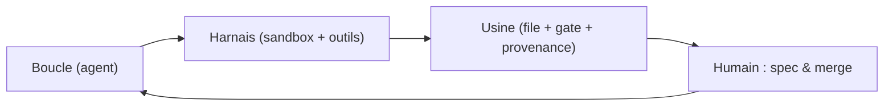
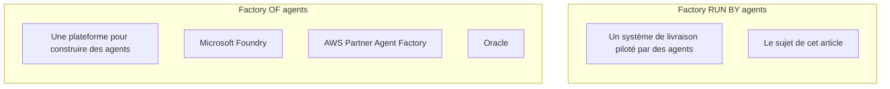
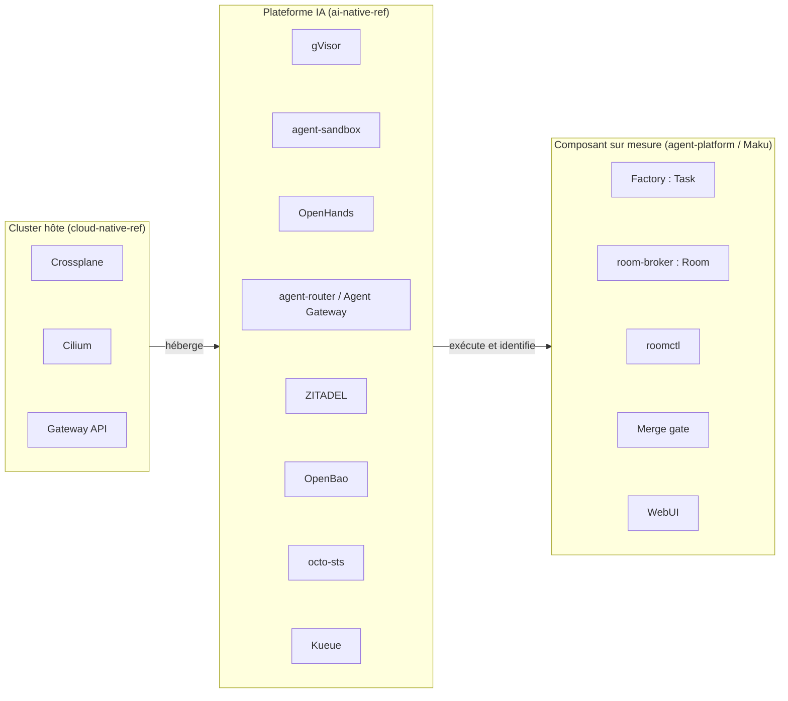
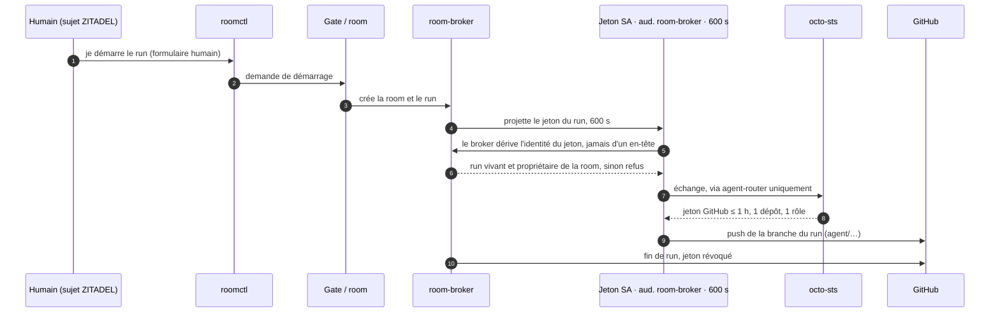
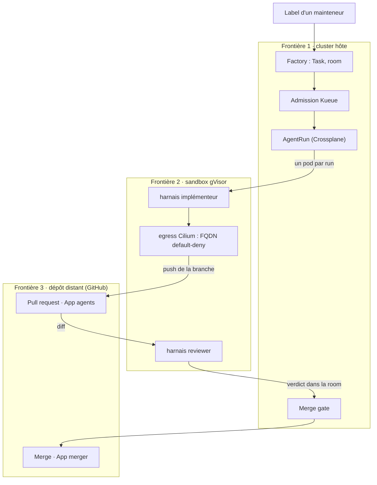

+++
author = "Smaine Kahlouch"
title = "Agent factory cloud-native : déléguer un merge sans abandonner le contrôle"
date = "2026-11-04"
summary = "Anatomie d'une agent factory cloud-native : identité par run, sandbox gVisor, egress Cilium, gate mesuré, coûts datés — et ce qui ne marche pas encore."
featured = false
draft = true
codeMaxLines = 30
usePageBundles = true
toc = true
series = ["Agentic AI"]
tags = ["ai", "kubernetes", "platform-engineering", "security"]
categories = []
thumbnail = "thumbnail.png"
+++

Dex Horthy a construit une usine logicielle entièrement automatisée. Elle a tenu environ quatre mois. Elle n'est pas morte d'un bug, mais de **dette de compréhension** (*comprehension debt*, le coût de ne plus savoir pourquoi un bout de code existe, parce que plus personne n'a suivi la décision qui l'a produit). <!-- status: V -->

Le contraste avec notre plateforme est instructif. **Deux lanes** (*lanes*, des voies de livraison automatisées, une par type de changement) y tournent seules : la vérification des liens de la documentation, et un *revert* automatique qui sert de disjoncteur. Le reste est en **shadow** : les agents proposent, un humain exécute, nous comparons. Personne dans l'équipe n'appelle ça de l'autonomie. <!-- status: V -->

Ce n'est pas de la modestie, c'est de la comptabilité : une lane ne passe en production que quand ses merges concluants dépassent ce que le hasard explique. Et le plus coûteux n'a pas été le modèle — une ligne de configuration que l'on change en une minute — mais l'**identité**, l'**egress** (*egress*, le trafic sortant autorisé) et la **preuve** de ce qui s'est passé. Une machine à qui l'on confie un accès git doit être identifiable, révocable et auditable. <!-- status: W -->

La question n'est donc pas *est-ce qu'un modèle sait coder*, mais : **qu'est-ce qui doit être vrai pour qu'on délègue un merge à une machine ?**

{}
Chaque chiffre porte sa date et sa taille d'échantillon. Le composant d'orchestration (Maku, v3) est en cours : les sections distinguent explicitement ce qui est validé, ce qui est en cours et ce qui manque. L'article sera mis à jour quand la v3 sera terminée.
{}

## 🎯 Objectifs de cet article

À la fin de cet article, vous saurez :

* distinguer une **factory of agents** (une plateforme pour construire des agents) d'une **factory run by agents** (un système de livraison piloté par des agents) ;
* nommer les **six capacités** indépendantes de la technologie : intake, isolation, identité, egress, boucle réutilisable, coût et observabilité par run ;
* traduire chacune de ces capacités en composant cloud-native, et voir ce qui reste sur mesure ;
* suivre une identité de bout en bout : un humain, plusieurs agents, un token par run ;
* parcourir deux scénarios réels : développeur backend, puis ingénieur plateforme ;
* lire des chiffres datés — coût, latence, cache — avec leur taille d'échantillon ;
* savoir ce qui manque encore, avant la conclusion ;
* repartir avec une grille de décision pour votre contexte.

## 🧠 Concepts : boucle, harnais, usine

Trois mots reviennent dans toutes les conversations sur le sujet, et ils ne désignent pas la même chose. Une **boucle** (*loop*) est le cycle par lequel un modèle observe, agit, puis observe le résultat : c'est le niveau du modèle. Un **harnais** (*harness*) est ce qui transforme cette boucle en travail utile — un sandbox, des outils, des permissions, un contexte : c'est le niveau de l'exécution. Une **usine** (*factory*) est un ensemble de boucles harnachées, une **file** (*queue*) qui les alimente et un **gate de revue** qui les filtre : c'est le niveau du système. Ces trois niveaux s'emboîtent, et la plupart des désaccords publics viennent de gens qui parlent de l'un en croyant parler de l'autre.



Cette hiérarchie vient d'Addy Osmani, et son mérite est de nommer le point qui compte vraiment : quelqu'un possède la **boucle extérieure**, celle qui écrit la spec et qui merge. Le reste — le nombre de boucles, leur parallélisme, la finesse des outils — n'est que de l'implémentation. Dan Shapiro range les organisations sur cinq niveaux, dont trois suffisent ici (un **diff** désigne la différence de code proposée dans une *pull request*, ou **PR**) :

| Niveau | Qui lit les diffs | Ce que l'humain possède |
|---|---|---|
| **L3** | un humain, chaque diff | le code |
| **L4** | un humain, les cas risqués | la spec et le gate |
| **L5**, dit *dark* | personne, diff par diff | la spec et la responsabilité du résultat |

Nous sommes en **L4** : l'humain écrit la spec et le gate, les agents construisent. Le L5 n'a pas de cas public vérifié — l'usine morte en quatre mois en est le contre-exemple le plus documenté — et l'essai contrôlé de METR (*Model Evaluation & Threat Research*, l'organisme qui l'a publié), publié le **2025-07-10** auprès de **16 développeurs expérimentés travaillant sur 246 issues réelles**, mesurait un ralentissement de **19 %** avec l'IA. La mise à jour de 2026, dont la cohorte ajoutée est distincte, atténue cet effet sans démontrer d'accélération. Autrement dit, le passage au L5 ne s'achète pas avec un meilleur modèle : il faut que la qualité mesurée et la compréhension du code tiennent sans relecture humaine. Rien dans les sources publiques ne le montre aujourd'hui. <!-- status: V -->

La seconde source de confusion est le mot lui-même. En 2026, le marketing appelle *agent factory* une plateforme pour **construire** des agents ; les praticiens appellent du même mot un système de **livraison** piloté par des agents. Ce sont deux marchés différents, qui ne répondent pas à la même question — et chercher le premier quand on veut le second mène droit à une page produit. Gardez ce réflexe : si la page vend des *agents métier* prêts à l'emploi, vous êtes dans la colonne de gauche. <!-- status: V -->



Notre sujet est la colonne de droite : un système où des agents prennent une partie du travail de livraison, avec une file, des sandboxes, des identités et un gate. Et « dark » mérite une définition que nous assumerons jusqu'à la dernière section : *dark* veut dire que **personne ne lit chaque diff**, pas que personne n'est responsable. Un humain écrit la spec, arbitre les cas risqués et répond du merge ; ce qui disparaît, c'est la relecture ligne à ligne de tout ce que la machine produit. Cette nuance paraît cosmétique ; elle décide en réalité de tout le reste, parce qu'elle détermine quels contrôles doivent exister **avant** le gate pour que son absence de lecture soit défendable. C'est le fil de l'article : une **approbation** est un acte de supervision, pas une frontière de sécurité, et une frontière se construit — identité, sandbox, egress, provenance — avant que le diff n'arrive.

## 🧱 Six capacités, indépendantes de la techno

Avant de comparer des outils, il faut un vocabulaire qui ne dépende d'aucun d'eux. Une agent factory répond à six questions, et elles se posent de la même façon que vous louiez un service ou que vous montiez le vôtre. Ce filtre est utile dans les deux sens : un composant qui ne répond à aucune des six n'appartient pas à la factory — c'est un éditeur de code, un chatbot ou un script — et une capacité que personne ne nomme est presque toujours celle qui manquera au premier incident. <!-- status: V -->

| Capacité | Question à laquelle elle répond | Ce qui casse sans elle |
|---|---|---|
| **Intake** — d'où vient le travail | Quelle source décide de ce qui sera fait, dans quel ordre, avec quel plafond de dépense ? | Des runs lancés à la main : pas de file, donc pas de priorité ; pas de déduplication, donc le même ticket payé deux fois ; pas de plafond, donc une facture qui ne se discute qu'à la fin du mois. |
| **Isolation** — où le code s'exécute | Sur quoi l'agent a-t-il réellement les mains, et qu'est-ce qui l'empêche d'en sortir ? | Un contenu piégé lit les identifiants de l'hôte et les runs voisins. La sandbox n'est pas un confort de développement, c'est le seul endroit où l'on accepte d'exécuter du code non relu. |
| **Identité** — qui agit, avec quel jeton | Qui a poussé ce commit, sur quel dépôt, et comment révoque-t-on ce droit en trente secondes ? | Tout se fait sous votre compte personnel : l'audit ne distingue plus l'agent de vous, et un incident ne se révoque qu'en changeant votre mot de passe. |
| **Egress et gouvernance** — ce que l'agent peut joindre | Quelles destinations sortent, pour quelle classe de données, et qui le décide ailleurs que dans le prompt ? | Le canal de sortie devient le canal d'exfiltration, et la politique de données se résume à ce que le modèle a bien voulu respecter. |
| **Boucle réutilisable** — l'API du harnais | Peut-on relancer la même boucle sur un deuxième dépôt, ou sur un deuxième fournisseur de modèle, sans réécrire l'intégration ? | Chaque dépôt devient un fork : l'outillage se duplique, et le coût de maintenance dépasse le temps gagné sur les runs. |
| **Coût et observabilité par run** | Combien a coûté ce run précis, qu'a-t-il appelé, et à quel moment a-t-il dérivé ? | Une facture mensuelle agrégée et un incident anonyme. Élargir l'autonomie devient alors une opinion, pas une décision. |

Le **gate de revue** n'est volontairement pas dans ce tableau : dans notre relevé d'octobre 2026, les produits comparés savent ouvrir une branche ou une *pull request* et la soumettre à un contrôle humain. Ce n'est plus un différenciateur mais le plancher. Ce qui décide de ce que vous pourrez déléguer tient en quatre axes : **où se situe la frontière de confiance** (auto-hébergé, API managée, VPC dédié), **si la boucle est exposée comme une API réutilisable**, **la granularité de l'identité et de la gouvernance** (par run ou par dépôt), et **le coût et l'observabilité par run**. Cette lecture porte sur une dizaine de produits et leur documentation primaire : elle décrit une architecture, pas un classement universel. <!-- status: V -->

## ☁️ La traduction cloud-native : qui fait quoi

Ces six capacités, il faut les loger quelque part. Chez nous, elles se répartissent sur trois couches, et la distinction n'est pas cosmétique : elle dit qui vous mettez à jour quand quelque chose casse, et à qui appartient la frontière de confiance. Le **cluster hôte** fournit l'infrastructure ; la **plateforme IA** fournit l'exécution, l'identité et la sortie réseau ; le **composant sur mesure** fournit l'orchestration, le journal et le gate. <!-- status: I -->



Le tableau associe chaque composant à son rôle, son dépôt et son état. **Validé** signifie mesuré par un runbook daté ou un run réel ; **implémenté, non mesuré**, en fonctionnement sans preuve chiffrée publiable ; **en cours**, partiel et susceptible de changer ; **absent**, non branché. La distinction évite de confondre une fonctionnalité stable mais non mesurée avec un chantier encore mouvant.

| Composant | Rôle dans la factory | Dépôt | Statut |
|---|---|---|---|
| **Crossplane** | Compose l'`AgentRun` et crée la sandbox à partir d'une réclamation, sans intervention humaine | cloud-native-ref | validé <!-- status: V --> |
| **Cilium** | Maille et **egress** : refus par défaut, liste d'autorisation par nom de domaine, refus au niveau DNS | cloud-native-ref | validé <!-- status: V --> |
| **Gateway API** | Expose les interfaces internes (UI des rooms, agents) derrière la Tailscale Gateway | cloud-native-ref | validé <!-- status: V --> |
| **gVisor** | Intercepte les appels système du pod de run ; pool de nœuds dédié `agents-gvisor` | ai-native-ref | validé <!-- status: V --> |
| **agent-sandbox** | La primitive Kubernetes du pod de run : `Sandbox`, gabarit, réclamation | ai-native-ref | validé <!-- status: V --> |
| **agent-router / Agent Gateway** | Seul chemin du sandbox vers les modèles, les outils MCP et GitHub ; valide le jeton et injecte les identifiants fournisseur | ai-native-ref | validé <!-- status: V --> |
| **OpenHands** (`agent-server`, uid 10001) | Le harnais : boucle d'agent, terminal, `git`, ouverture de la PR | ai-native-ref | validé <!-- status: V --> |
| **ZITADEL** | Fournisseur d'identité des humains : OIDC, rôles de projet, groupes | ai-native-ref | validé <!-- status: V --> |
| **OpenBao** | Coffre des secrets ; un rôle par usage, un store restreint par namespace | ai-native-ref | validé <!-- status: V --> |
| **octo-sts** | Échange le jeton du run contre un jeton GitHub court, borné à un dépôt et à un rôle | ai-native-ref | validé <!-- status: V --> |
| **Kueue** | Admet les sandboxes dans des files plafonnées (factory / interactif) | ai-native-ref | implémenté, non mesuré <!-- status: I --> |
| **Factory** (`agent-factory`, CRD `Task`) | Prend une issue étiquetée, crée la room, lance les runs, mesure, narre sur l'issue | agent-platform-maku | validé <!-- status: V --> |
| **room-broker** (CRD `Room`) | Le journal de référence : il authentifie chaque écrivain, caviarde, séquence et scelle | agent-platform-maku | validé <!-- status: V --> |
| **`roomctl`** | Le client terminal des humains : regarder, poster, mettre en file, forker | agent-platform-maku | validé <!-- status: V --> |
| **Merge gate** | Lit la PR dans l'ordre, ligne par ligne, et ne merge que ce que la classe autorise | agent-platform-maku | validé <!-- status: V --> |
| **WebUI** | Carte d'approbation, file « needs-you », pilotage de la room | agent-platform-maku | validé <!-- status: V --> |
| **RunLore** | La boucle incident agent-à-agent : alerte → investigation → correctif proposé | ai-native-ref | en cours <!-- status: W --> |

**Maku** est le nom produit retenu le **2026-10-27** ; module, binaires, images, CRD et API restent `agent-platform` et `agent-factory` jusqu'au renommage. Surtout, **Maku n'est pas la factory** : il assure l'orchestration et le journal dans la troisième couche. Le harnais, la sandbox, l'identité et l'egress appartiennent à la plateforme, le cluster au socle. <!-- status: V -->

### Maku : ce que fait le composant sur mesure

Le composant fait trois choses. La **room** est un journal **append-only** par tâche : `seq` sans trou, clé d'idempotence par événement (`room_id`, client, numéro d'origine) et **sceau** définitif, qui refuse tout ajout jusqu'au niveau de la base. `roomctl` regarde, poste, met en file et forke, mais ne pilote pas et **n'approuve jamais**. Enfin, le **merge gate** applique un ordre fixe de contrôles, du scan de secrets à l'identité de l'auteur, et renvoie chaque refus vers un humain : c'est du code, pas une politique dans un wiki. <!-- status: V -->

Ce que le composant ne fait pas est aussi important. **Aucun classifieur n'est déployé** : quand l'URL du classifieur n'est pas configurée, aucun appel n'a lieu et chaque tâche prend le palier statique `standard` ; les paliers, les plafonds et les gabarits sont réels, le tri intelligent ne l'est pas <!-- status: X -->. Le modèle logique demandé reste `agent-default`. Les **budgets** par run et par tâche, en dollars, sont appliqués ; le budget par personne compte en shadow (`budget-principal-shadow`) et ne refuse qu'une fois l'option d'application activée ; le budget de flotte met le run en attente plutôt que de le refuser. <!-- status: W --> Le **scoper** (qui découpe ou questionne une issue), le **split** et le **tester** existent dans la documentation et les runbooks de preuve, avec leurs interrupteurs éteints : aucune preuve live publiée <!-- status: X -->. Le **compte machine sponsorisé** — un compte machine ZITADEL qu'un mainteneur parraine pour ouvrir du travail à sa place, avec son propre budget en dollars — est lui aussi éteint par défaut : sans entrée `api.sponsored`, la route `POST /v1/tasks` répond `404` et aucun principal machine ne crée de tâche. Le chemin est écrit et testé en runbook, pas encore prouvé live. <!-- status: W -->

{}
Quatre limites avant de nous comparer à un produit fini : **aucun classifieur de complexité** n'est déployé <!-- status: X --> ; les **budgets par personne et par flotte** comptent ou mettent en attente, sans refuser <!-- status: W --> ; **`scoper`, `split` et `tester`** n'ont pas de preuve live <!-- status: X --> ; le **compte machine sponsorisé**, éteint par défaut, reste lui aussi sans preuve live <!-- status: W -->. Les deux lanes autonomes et le reste en shadow sont détaillés plus loin.
{}

## 🔐 Sécurité de bout en bout : une identité par run

La question de sécurité d'une factory tient en une phrase : **qui agit, sous quel jeton, et jusqu'où ce jeton porte-t-il ?** Chez nous, la réponse est une chaîne de trois identités distinctes, et aucune ne se déduit d'un en-tête HTTP. Un humain (`human:<sub>`, le sujet ZITADEL) déclenche ; un run (`agent:<runId>`) exécute ; GitHub voit l'application des agents, jamais votre compte. <!-- status: V -->



Le jeton du run est un jeton de compte de service projeté, d'audience `room-broker`, valable 600 secondes, monté **uniquement** dans le conteneur du pont de room : le harnais lui-même ne le voit jamais. Le broker ne fait pas confiance à l'en-tête qui prétend désigner l'agent ; il dérive le principal du jeton vérifié hors ligne, puis exige que le run existe encore et nomme bien cette room. Côté GitHub, `octo-sts` échange ce jeton contre un accès de **une heure au plus**, limité à **un dépôt et un rôle** — un implémenteur pousse sa branche `agent/**`, un reviewer ne pousse pas du tout —, et le droit disparaît avec le run. L'application des agents ne merge jamais : seule l'application de merge du factory en a la clé, et une seule charge de travail la monte. <!-- status: V -->

Reste à voir un run entier, et ses trois frontières.



Le code des agents ne peut pas créer de run : un humain ou la boucle de mesure le fait, via une file plafonnée. Dans la sandbox, l'egress est refusé par défaut **à la résolution de nom**, pas seulement au niveau TCP — lors du round 7 de nos runbooks, le 2026-09-30 sur `gcp-0`, Hubble a confirmé qu'un nom non autorisé ne résolvait pas. Sur le dépôt distant, l'application pousse une branche dont le diff et le verdict restent attachés à un run identifiable. <!-- status: V -->

L'isolation est un **spectre**, pas un label. Un conteneur ordinaire partage le noyau du nœud : bon marché, compatible, et une seule évasion d'appel système suffit. gVisor intercale un noyau utilisateur qui intercepte ces appels : la surface d'attaque se réduit au *Sentry* de gVisor, au prix de la compatibilité et d'un surcoût. Un **microVM** (Firecracker) repousse la frontière au niveau matériel ; ses auteurs annoncent un démarrage sous 125 ms pour moins de 5 Mio de surcoût — des **caractéristiques de conception annoncées par le projet** (documentation consultée le **2026-10-28**), pas des mesures issues d'un benchmark d'agents de codage. Nous avons choisi gVisor parce qu'il est disponible sur les deux clouds que nous visons et que la primitive `agent-sandbox` standardise le pod ; le prix est réel : sous gVisor le profil seccomp `RuntimeDefault` n'est pas appliqué (`Seccomp: 0` dans le pod), et c'est le *Sentry* qui tient la frontière. Qui prétend que gVisor est « plus sûr » que Firecracker sans dire ce qu'il abandonne n'a pas regardé le compromis. <!-- status: V -->

Le corollaire, c'est que **les identifiants ne vivent pas dans la sandbox**. Les clés des fournisseurs de modèles n'entrent jamais dans le namespace des agents : c'est la passerelle qui valide le jeton du run et injecte l'identifiant fournisseur, ce qui veut dire qu'un agent compromis ne peut pas exfiltrer une clé qu'il n'a jamais eue. Mais la sortie elle-même reste un canal : Anthropic documente un cas d'exfiltration **par l'endpoint d'inférence autorisé**, avec une clé fournie par l'attaquant — la requête au modèle est un chemin de sortie légitime, donc utilisable. Le même article rapporte qu'une injection collée par l'utilisateur a réussi **24 fois sur 25 tentatives** (recherche Anthropic sur le confinement, publiée en 2026). Traduction pratique : un filtre de modèle ne tient pas la frontière, un contrôle d'environnement la tient. C'est exactement la **trifecta létale** de Simon Willison — données privées, contenu non fiable, communication externe : réunissez les trois dans un même run et l'injection devient une exfiltration. Notre réponse est de couper le troisième terme par défaut, jamais de demander au modèle de se méfier. <!-- status: V -->

Enfin, une approbation n'est pas une frontière : c'est de la **supervision**. Ce qu'un run peut faire est fixé **à sa création**, hors de la sandbox, par son profil, ses plafonds et son jeton. Un agent ne s'approuve pas lui-même, `roomctl` n'approuve pas du tout, et la carte d'approbation affiche l'action brute caviardée plutôt que la prose de l'agent — parce qu'un humain qui approuve du texte rédigé par le modèle approuve un récit, pas une action. Et la fatigue est mesurable : dans un article publié le **2026-05-25**, Anthropic rapporte un taux d'approbation d'environ **93 %** sur ses invites de permission, sans publier la taille de l'échantillon de télémétrie — un signal d'usure, pas une preuve de sûreté. <!-- status: V -->

{}
Quatre angles morts nommés, et ils sont dans notre propre plateforme : le confinement de l'application des agents est celui d'une **installation par dépôt**, pas d'un run <!-- status: W --> ; le profil seccomp n'est **pas appliqué sous gVisor**, la frontière est le *Sentry* <!-- status: V --> ; les journaux de GitHub ne relient pas un jeton d'agent à un run <!-- TODO-check: corroborer l'absence d'enregistrement jeton → run dans les audits GitHub avant publication --> ; et une évasion du *Sentry* atteindrait l'identité du nœud, les sandboxes voisines et les identifiants du kubelet — d'où le pool dédié, l'IMDS bridé et le recyclage quotidien des nœuds, qui réduisent l'impact sans l'annuler <!-- status: V -->.
{}

## 🧑‍💻 Scénario 1 : un développeur backend

Vous reproduisez le défaut dans `opencode`, `claude` ou votre client, puis demandez `/factory handoff`. `roomctl` fait vérifier le brouillon d'issue par le broker — symptôme, résultat attendu, critère d'acceptation, absence de secret — sans rien déposer. Vous relisez le texte exact avant que votre `gh` le publie. <!-- status: V -->

Le démarrage reste **votre geste** : l'option *start* du formulaire, à non par défaut, est la seule qui applique ensuite `factory/ready`. Ni argument d'outil, ni label posé sur la parole de l'agent, ni run automatique. La factory ouvre alors la room et le premier run. <!-- status: V -->

Dans **needs-you**, la carte d'approbation montre la commande puis **l'action brute caviardée**, jamais le récit de l'agent. Vous décidez dans la WebUI. Le reviewer rend ensuite son verdict dans la room ; l'implémenteur pousse la branche et ouvre la PR. <!-- status: V -->

<!-- TODO-shot: S1 — file needs-you et carte d'approbation avec action brute caviardée ; capture live ou replay daté, sans donnée de fixture -->

Le pied de PR porte la provenance, écrite par le harnais plutôt que par le modèle :

```text
---
Agent-Room: <room>
Agent-Run: <run>
Agent-Task: <task>
```

Ces *trailers* relient le travail à son exécution, sans rien autoriser. Après la CI, le gate vérifie verdict et provenance, puis **un mainteneur merge** hors des classes live. Le reviewer ne remplace ni ce contrôle ni cette responsabilité. <!-- status: V -->

<!-- TODO-shot: S2 — pied de PR avec trailers de provenance et identité du bot ; capture live ou replay daté, sans donnée de fixture -->

### Ce que montre réellement le parcours de l'issue #2238 / PR #2239

Ce parcours du **2026-10-07** est parti d'un label, pas du chemin `roomctl` décrit ci-dessus. Il donne néanmoins un parcours mesuré, avec quatre intervalles après le label : <!-- status: V -->

| Jalon (UTC) | Horodatage | Depuis le label |
|---|---:|---:|
| Label sur l'issue #2238 | 18:40:15 | 0 |
| PR #2239 ouverte | 18:45 | 4 min |
| *Request changes* | 19:11:30 | +31 min |
| Révision poussée | 19:22 | +42 min |
| Approbation du mainteneur | 19:24:42 | +44 min |

**Échantillon : une tâche et une PR, cinq runs d'agent.** Une récupération Spot a interrompu la révision, reprise depuis son checkpoint. La PR fut approuvée puis **fermée sans merge** : preuve de révision et de reprise, pas de livraison autonome. Les fixtures `internal/roomview/testdata` réutilisent ces numéros ; leurs captures ne sont pas des runs réels. <!-- status: V -->

## 🛠️ Scénario 2 : un ingénieur plateforme

Côté plateforme, nous exploitons des **classes** et leurs preuves. Sur `cloud-native-ref`, `docs-links` et son disjoncteur `revert` sont live ; `dead-links` et `deps` (`deps-patch`, `deps-minor`) sont en shadow : le gate juge sans merger. Si tout passerait, `shadow_would_arm` enregistre le head ; un humain merge ensuite et nous comparons. Ces décisions alimentent l'échantillon de promotion, pas le taux de merge autonome. <!-- status: V -->

Sur une action risquée, la règle **four-eyes**, quand la room l'exige, interdit à quiconque a prompté le tour de l'approuver. Exemple de refus : une PR `docs-links` touchant `.github/` devient `gate_path` chez `policy-bot` et repart vers un humain, même avec liens et CI corrects. <!-- status: V -->

### Le gate réel : 13 entrées, dans l'ordre

Gate relu dans `docs/factory.md` le **2026-10-28** : `1`, `2a`, `2`, puis `3` à `12`, soit treize contrôles. Chaque « non » échoue vers un humain. <!-- status: V -->

| # | Contrôle, dans l'ordre | Refus ou attente |
|---|---|---|
| 1 | Le scan de secrets n'est pas rouge | `secret_scan_red` |
| 2a | Le fence du dépôt nomme cette factory | `not_owned` |
| 2 | Tous les checks requis sont verts | Rouge : run de correction borné puis `ci_red` ; annulé : relance bornée ; en cours : attente |
| 3 | `policy-bot: main` est vert et vient du login attendu | `policy_absent`, `policy_pending`, `gate_path` |
| 4 | L'auteur est l'App des agents, sans approbation de mainteneur | `not_agent_authored`, `maintainer_approved` |
| 5 | La classe est live ou shadow | `class_unarmed` |
| 6 | Le reviewer approuve le head rapporté ; tous les verdicts portent sur ce head | `no_approving_verdict`, `head_unreported`, `verdict_stale` |
| 7 | Le trailer `Agent-Run` du head nomme un run de la tâche | `foreign_trailer` |
| 8 | Les conditions de la classe passent : chemins, fichiers protégés, modification seule, taille, forme du diff, holdouts et oracle | Par exemple `file_protected`, `patch_too_large`, `class_mismatch`, `holdout_red` |
| 9 | Le breaker de la classe n'a pas sauté | `class_paused` |
| 10 | Les plafonds quotidiens global et de classe, ainsi que le plafond par requête, ne sont pas atteints | `auto_merge_cap` |
| 11 | La classe est live | Sinon `shadow_would_arm`, sans merge |
| 12 | Chaque push de la branche vient de l'App des agents | `human_commit_in_pr` |

La promotion exige une borne supérieure unilatérale de **Clopper-Pearson à 95 %** sous `0,10`, calculée hors merges immatures et non concluants. Avec zéro mauvais merge, il faut **29 merges concluants** — ni PR ouvertes, ni décisions shadow seules. Règle relevée le 2026-10-28. <!-- status: V -->

### Le DevX autour du gate

Dans Slack, `@factory` vérifie votre brouillon sans rien générer. Le ✅ ne dépose et ne démarre que pour un utilisateur lié à un mainteneur, sur le brouillon du bot dont l'empreinte correspond. Le fil suit les états sans recopier le transcript. Chemin implémenté, preuve Slack live non publiée. <!-- status: W -->

La file **needs-you** rassemble les attentes humaines. Les approbations restent **exclusivement dans la WebUI** : jamais dans Slack, `roomctl` ou par un agent. <!-- status: V -->

## 🩺 RunLore : la boucle incident, honnêtement

RunLore analyse nos alertes. La boucle visée, conçue le **2026-10-27**, part de `system:runlore` : une tâche `investigate` propose sans écrire ; un stub public ne contient ni finding interne ni preuve ; le mainteneur applique `factory/publish` pour publier la proposition comme issue de correctif ; après relecture, un second label `factory/ready` démarre ; des webhooks signés relient le travail à l'incident ; après merge, un *soak* de 30 min aboutit à `resolved` ou `persisting`. <!-- status: W -->

Le second label contrôle **la dépense** : le premier autorise la publication, le second un nouveau run. Entre les deux, le mainteneur lit ce qui devient public et ce qui va coûter. `persisting` alimente le monitoring post-merge et peut suspendre la classe, sans dépenser seul. <!-- status: W -->

{}
Je n'ai pas de preuve live d'un incident semé traversant cette chaîne. **La boucle sans humain n'est donc pas démontrée** : c'est la prochaine candidate au statut de lane, pas une fonctionnalité livrée. <!-- status: X -->
{}

## 📊 Performance, coûts et monitoring

Ces mesures figées portent date et échantillon ; les coûts « sans cache » sont des recalculs tarifaires, pas des seconds runs. <!-- status: V -->

| Mesure | Valeur | Date | Échantillon |
|---|---:|---|---|
| Label → PR, parcours de l'issue #2238 / PR #2239 | 4 min | 2026-10-07 | Une tâche et une PR |
| Jalons de revue après le label : *request changes* / révision / approbation | +31 / +42 / +44 min | 2026-10-07 | Le même parcours unique |
| Tokens du parcours #2238 / #2239 | 1,078 M | 2026-10-07 | Une tâche, cinq runs d'agent, total final |
| Part des entrées lues dans le cache | 95,1 % | 2026-10-18 | Tous les appels agents de `gcp-0`, fenêtre live de 24 h |
| Coût mesuré / coût recalculé sans cache | 10,40 $ / 41,64 $ | 2026-10-18 | La même fenêtre de 24 h |
| Run `jcp6kl72`, coût mesuré / recalculé sans cache | 1,6487 $ / 6,39 $ | 2026-10-18 | Un run implémenteur, PR #2508 |
| Démarrage de sandbox à chaud / à froid | 16–17 s / 1,5–3,5 min | 2026-10-17 | Dix runs à chaud en test compressé ; plage froide du pool |
| Nœud gardé à chaud | 126 $/mois, extrapolé | 2026-10-17 | Une heure de mesure du nœud idle |
| Acceptation sur issues difficiles : Claude / GLM-5.3 via la factory | 13/15 / 0/15 | 2026-10-14 au 2026-10-15 | Quinze issues par bras, un run par issue, un seul dépôt |

Un parcours n'est pas une distribution, une fenêtre de cache n'est pas une garantie mensuelle, et le nœud à chaud reste **off par défaut**. La cohorte mono-dépôt justifie de choisir et mesurer par palier ; elle ne classe pas les modèles en général et ne valide pas un classifieur. <!-- status: V -->

### Ce que nous instrumentons

Les séries `agent_factory_*` couvrent phases, latence, issues, tokens, coûts, budgets et décisions du gate. La trace d'un run garde étapes et appels en métadonnées seulement : **ni prompt ni sortie**. Le transcript complet reste dans la room, sous contrôle d'accès ; les spans côté room sont incomplets. <!-- status: W -->

La distribution aux lecteurs de la room expose aussi `rooms_fanout_lag_seconds`. Sa cible est un **p95 inférieur à 0,5 s**, relevée comme objectif le 2026-10-28 ; ce n'est pas un résultat mesuré publié ici. <!-- status: W -->

<!-- TODO-shot: S3 — dashboard coût/cache/latence d'un run réel, avec date et identifiant ; ne pas substituer de données de fixture -->

Trois limites externes. Les attributs agent et outil d'[OpenTelemetry `gen_ai.*`](https://opentelemetry.io/docs/specs/semconv/registry/attributes/gen-ai/) restent **Development** : leurs noms peuvent bouger. [DORA 2025](https://dora.dev/research/2025/dora-report/) associe adoption de l'IA, débit en hausse et stabilité en baisse au niveau agrégé, sans valider notre factory ; [Faros](https://www.faros.ai/blog/ai-software-engineering) offre des hypothèses mono-éditeur, pas une loi. Enfin, le **coût par changement accepté** — dépense totale, échecs compris, divisée par les changements acceptés — n'est pas standardisé : nous le suivons sans le comparer tel quel ailleurs. <!-- status: V -->

## 💭 Dernières remarques

Je ne rangerais plus l'autonomie parmi les fonctionnalités d'un produit. C'est un **privilège calibré par lane**, réversible et borné par la classe de changement. Une correction de liens et une mise à jour de dépendances ne présentent ni le même risque ni la même preuve ; elles ne méritent donc pas le même droit de merger. Le modèle peut rester identique : ce qui change, c'est le nombre de résultats concluants, la sévérité du gate et la capacité à revenir en arrière. Cette règle évite de transformer quelques démos réussies en prétention d'autonomie générale.

Le point dur n'a pas été le modèle. Le remplacer tient dans une configuration ; faire en sorte qu'un run agisse sous une identité courte, sans secret durable ni sortie réseau implicite, et laisse une preuve consultable touche toute la plateforme. Le modèle produit un diff, mais la factory doit pouvoir dire **qui a agi, avec quels droits et jusqu'où**, sans croire le récit de l'agent. L'identité et l'egress ont donc davantage structuré nos choix que le classement du moment.

Le prochain investissement le moins rentable serait, à mes yeux, le classifieur de complexité. Notre petit échantillon mono-dépôt aide à choisir un modèle par palier ; il ne démontre pas qu'un routeur saura généraliser cette décision. Un second dépôt éprouverait au contraire la portabilité de la factory, de son verrou de propriété du dépôt et de ses preuves. Une démonstration RunLore de bout en bout testerait une nouvelle lane et la dépense qu'elle autorise. Avant d'automatiser davantage de décisions, je préfère élargir ce que nous savons vérifier.

La comparaison avec Copilot, Codex, Devin ou OpenHands reste asymétrique. Ils gagnent sur le clé-en-main, l'intégration à leurs surfaces de travail et le temps nécessaire pour obtenir une première PR ; notre assemblage demande un cluster, plusieurs composants et une exploitation réelle. En revanche, nous possédons ici la **frontière de confiance** et la **piste d'audit** : nous pouvons changer une règle d'egress, relier un verdict à un run et conserver le journal sans dépendre d'un service externe. Ce n'est pas une victoire universelle, mais un arbitrage entre adoption immédiate et contrôle du socle.

Maku v3, qui n'est que le composant d'orchestration de cette factory, est encore en cours. Je mettrai cet article à jour lorsque son état et les preuves changeront, en conservant la date et l'échantillon de chaque mesure. L'objectif n'est pas d'annoncer une usine vide d'humains : c'est de savoir précisément quelle lane peut merger sans intervention humaine, pourquoi, et comment lui retirer ce privilège.

## 📚 Références

### Dépôts et démonstration

* [Maku / agent-platform — orchestration, rooms et merge gate](https://github.com/Smana/agent-platform)
* [ai-native-ref — plateforme IA déployable](https://github.com/Smana/ai-native-ref)
* [cloud-native-ref — cluster hôte de référence](https://github.com/Smana/cloud-native-ref)
* [Replay public de la démonstration Maku](https://blog.ogenki.io/agent-platform/)
* [RunLore — transformer les alertes en boucle d'apprentissage](/fr/post/series/observability/runlore/)
* [Agentic Coding — concepts et cas concrets](/fr/post/series/agentic_ai/ai-coding-agent/)

### Standards et identité

* [NIST NCCoE — identité et autorisation des agents logiciels et IA](https://www.nccoe.nist.gov/projects/software-and-ai-agent-identity-and-authorization)
* [IETF — jetons de transaction, brouillon -11](https://datatracker.ietf.org/doc/draft-ietf-oauth-transaction-tokens/11/)
* [OpenTelemetry — attributs sémantiques `gen_ai`](https://opentelemetry.io/docs/specs/semconv/registry/attributes/gen-ai/)
* [gVisor — documentation de l'isolation des conteneurs](https://gvisor.dev/docs/)
* [Firecracker — documentation des microVM](https://firecracker-microvm.github.io/)
* [Kubernetes agent-sandbox — guide de la primitive Sandbox](https://agent-sandbox.sigs.k8s.io/docs/guides/)

### Documentation produit

* [GitHub — fonctionnement de l'agent cloud Copilot](https://docs.github.com/copilot/concepts/agents/cloud-agent/about-cloud-agent)
* [GitHub — configuration de l'accès Internet de l'agent Copilot](https://github.blog/changelog/2025-07-15-configure-internet-access-for-copilot-coding-agent)
* [OpenAI — documentation officielle de Codex Cloud](https://developers.openai.com/codex/cloud)
* [OpenAI — présentation de l'Agents API](https://openai.com/index/introducing-the-agents-api)
* [Cognition — architecture et usages de Devin 2](https://cognition.com/blog/devin-2)
* [OpenHands — agents de codage open source](https://www.openhands.dev/blog/open-source-ai-coding-agents)
* [Anthropic — confinement de Claude et limites de la sandbox](https://www.anthropic.com/research/how-we-contain-claude)
* [Anthropic — fonctionnement du sandboxing de Claude Code](https://www.anthropic.com/engineering/claude-code-sandboxing)

### Analyse indépendante

* [METR — essai contrôlé de 2025 auprès de développeurs open source expérimentés](https://metr.org/blog/2025-07-10-early-2025-ai-experienced-os-dev-study)
* [METR — mise à jour 2026 de l'estimation des gains de productivité](https://metr.org/blog/2026-02-24-uplift-update)
* [DORA — rapport 2025 sur l'IA et la livraison logicielle](https://dora.dev/research/2025/dora-report/)
* [Faros — analyse de l'IA dans l'ingénierie logicielle](https://www.faros.ai/blog/ai-software-engineering)
* [Vals AI — comparaison qualité, coût et durée sur SWE-bench](https://www.vals.ai/benchmarks/swebench)
* [Artificial Analysis — comparaison indépendante des agents de codage](https://artificialanalysis.ai/agents/coding-agents)
* [Hao Wang — limites et manipulations des benchmarks d'agents](https://moogician.github.io/blog/2026/trustworthy-benchmarks-cont)
* [Cloud Security Alliance — injection de prompt et confused deputy](https://labs.cloudsecurityalliance.org/research/csa-research-note-ai-agent-confused-deputy-prompt-injection/)
* [BeyondTrust — prise de contrôle de Copilot par injection cachée](https://www.beyondtrust.com/blog/entry/github-copilot-hidden-prompt-injection-agent-takeover)

### Essais praticiens

* [Addy Osmani — anatomie d'une usine logicielle](https://addyosmani.com/blog/software-factories)
* [Dan Shapiro — les cinq niveaux vers la software factory](https://www.danshapiro.com/blog/2026/01/the-five-levels-from-spicy-autocomplete-to-the-software-factory/)
* [Simon Willison — la trifecta létale des agents](https://simonwillison.net/2025/Jun/16/the-lethal-trifecta/)
* [Simon Willison — examen de la factory StrongDM](https://simonwillison.net/2026/Feb/7/software-factory/)
* [Dex Horthy — retour sur une usine automatisée, vidéo publiée le 30 juin 2026](https://youtu.be/htM02KMNZnk?t=27219)
* [StrongDM — présentation de sa software factory](https://factory.strongdm.ai)
