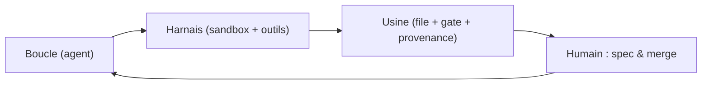
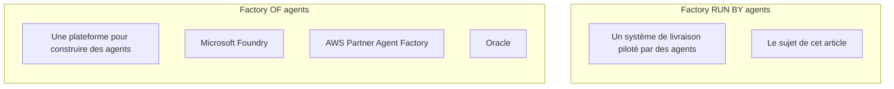

+++
author = "Smaine Kahlouch"
title = "Agent factory cloud-native : déléguer un merge sans abandonner le contrôle"
date = "2026-11-04"
summary = "De gVisor à Maku, en passant par Cilium, Kueue, ZITADEL et OpenBao : anatomie d'une agent factory cloud-native, ses chiffres datés, et ce qui ne marche pas encore."
featured = false
draft = true
codeMaxLines = 30
usePageBundles = true
toc = true
series = ["Agentic AI"]
tags = ["ai", "kubernetes", "platform-engineering", "security"]
categories = []
thumbnail = "thumbnail.png"
+++

Dex Horthy a construit une usine logicielle entièrement automatisée. Elle a tenu environ quatre mois. Elle n'est pas morte d'un bug, mais de **dette de compréhension** (*comprehension debt*, le coût de ne plus savoir pourquoi un bout de code existe, parce que plus personne n'a suivi la décision qui l'a produit). <!-- status: V -->

Le contraste avec notre plateforme est instructif. **Deux lanes** (*lanes*, des voies de livraison automatisées, une par type de changement) y tournent seules : la vérification des liens de la documentation, et un *revert* automatique qui sert de disjoncteur. Le reste est en **shadow** : les agents proposent, un humain exécute, nous comparons. Personne dans l'équipe n'appelle ça de l'autonomie. <!-- status: V -->

Ce n'est pas de la modestie, c'est de la comptabilité : une lane ne passe en production que quand ses merges concluants dépassent ce que le hasard explique. Et le plus coûteux n'a pas été le modèle — une ligne de configuration que l'on change en une minute — mais l'**identité**, l'**egress** (*egress*, le trafic sortant autorisé) et la **preuve** de ce qui s'est passé. Une machine à qui l'on confie un accès git doit être identifiable, révocable et auditable. <!-- status: W -->

La question n'est donc pas *est-ce qu'un modèle sait coder*, mais : **qu'est-ce qui doit être vrai pour qu'on délègue un merge à une machine ?**

{}
Les chiffres de cet article sont datés du **2026-10-18 au 2026-10-27** et portent leur taille d'échantillon. Le composant d'orchestration (Maku, v3) est en cours : les sections distinguent explicitement ce qui est validé, ce qui est en cours et ce qui manque. L'article sera mis à jour quand la v3 sera terminée.
{}

## 🎯 Objectifs de cet article

À la fin de cet article, vous saurez :

* distinguer une **factory of agents** (une plateforme pour construire des agents) d'une **factory run by agents** (un système de livraison piloté par des agents) ;
* nommer les **six capacités** indépendantes de la technologie : intake, isolation, identité, egress, boucle réutilisable, coût et observabilité par run ;
* traduire chacune de ces capacités en composant cloud-native, et voir ce qui reste sur mesure ;
* suivre une identité de bout en bout : un humain, plusieurs agents, un token par run ;
* parcourir deux scénarios réels : développeur backend, puis ingénieur plateforme ;
* lire des chiffres datés — coût, latence, cache — avec leur taille d'échantillon ;
* savoir ce qui manque encore, avant la conclusion ;
* repartir avec une grille de décision pour votre contexte.

## 🧠 Concepts : boucle, harnais, usine

Trois mots reviennent dans toutes les conversations sur le sujet, et ils ne désignent pas la même chose. Une **boucle** (*loop*) est le cycle par lequel un modèle observe, agit, puis observe le résultat : c'est le niveau du modèle. Un **harnais** (*harness*) est ce qui transforme cette boucle en travail utile — un sandbox, des outils, des permissions, un contexte : c'est le niveau de l'exécution. Une **usine** (*factory*) est un ensemble de boucles harnachées, une **file** (*queue*) qui les alimente et un **gate de revue** qui les filtre : c'est le niveau du système. Ces trois niveaux s'emboîtent, et la plupart des désaccords publics viennent de gens qui parlent de l'un en croyant parler de l'autre.

Cette hiérarchie vient d'Addy Osmani, et son mérite est de nommer le point qui compte vraiment : quelqu'un possède la **boucle extérieure**, celle qui écrit la spec et qui merge. Le reste — le nombre de boucles, leur parallélisme, la finesse des outils — n'est que de l'implémentation. Dan Shapiro range les organisations sur cinq niveaux, dont trois suffisent ici (un **diff** désigne la différence de code proposée dans une *pull request*, ou **PR**) :

| Niveau | Qui lit les diffs | Ce que l'humain possède |
|---|---|---|
| **L3** | un humain, chaque diff | le code |
| **L4** | un humain, les cas risqués | la spec et le gate |
| **L5**, dit *dark* | personne, diff par diff | la spec et la responsabilité du résultat |

Nous sommes en **L4** : l'humain écrit la spec et le gate, les agents construisent. Le L5 n'a pas de cas public vérifié — l'usine morte en quatre mois en est le contre-exemple le plus documenté — et l'essai contrôlé de METR (*Model Evaluation & Threat Research*, l'organisme qui l'a publié) n'a jamais trouvé d'accélération démontrée pour des développeurs expérimentés sur leur propre base de code : 19 % plus lent à l'origine, un effet atténué par la mise à jour de 2026, jamais inversé. Autrement dit, le passage au L5 ne s'achète pas avec un meilleur modèle : il faut que la qualité mesurée et la compréhension du code tiennent sans relecture humaine. Rien dans les sources publiques ne le montre aujourd'hui. <!-- status: V -->

La seconde source de confusion est le mot lui-même. En 2026, le marketing appelle *agent factory* une plateforme pour **construire** des agents ; les praticiens appellent du même mot un système de **livraison** piloté par des agents. Ce sont deux marchés différents, qui ne répondent pas à la même question — et chercher le premier quand on veut le second mène droit à une page produit. Gardez ce réflexe : si la page vend des *agents métier* prêts à l'emploi, vous êtes dans la colonne de gauche. <!-- status: V -->

Notre sujet est la colonne de droite : un système où des agents prennent une partie du travail de livraison, avec une file, des sandboxes, des identités et un gate. Et « dark » mérite une définition que nous assumerons jusqu'à la dernière section : *dark* veut dire que **personne ne lit chaque diff**, pas que personne n'est responsable. Un humain écrit la spec, arbitre les cas risqués et répond du merge ; ce qui disparaît, c'est la relecture ligne à ligne de tout ce que la machine produit. Cette nuance paraît cosmétique ; elle décide en réalité de tout le reste, parce qu'elle détermine quels contrôles doivent exister **avant** le gate pour que son absence de lecture soit défendable. C'est le fil de l'article : une **approbation** est un acte de supervision, pas une frontière de sécurité, et une frontière se construit — identité, sandbox, egress, provenance — avant que le diff n'arrive.

## 🧱 Six capacités, indépendantes de la techno

## ☁️ La traduction cloud-native : qui fait quoi

## 🔐 Sécurité de bout en bout : une identité par run

## 🧑‍💻 Scénario 1 : un développeur backend

## 🛠️ Scénario 2 : un ingénieur plateforme

## 🩺 RunLore : la boucle incident, honnêtement

## 📊 Performance, coûts et monitoring

## 💭 Dernières remarques

## 📚 Références
