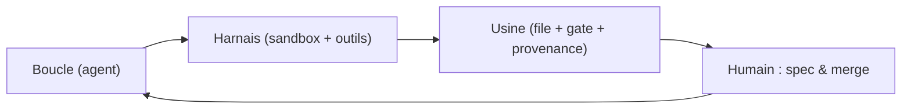
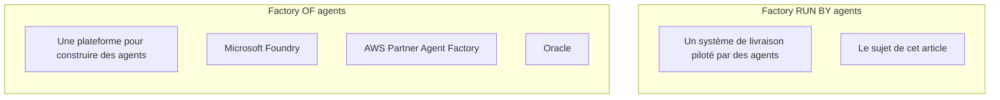
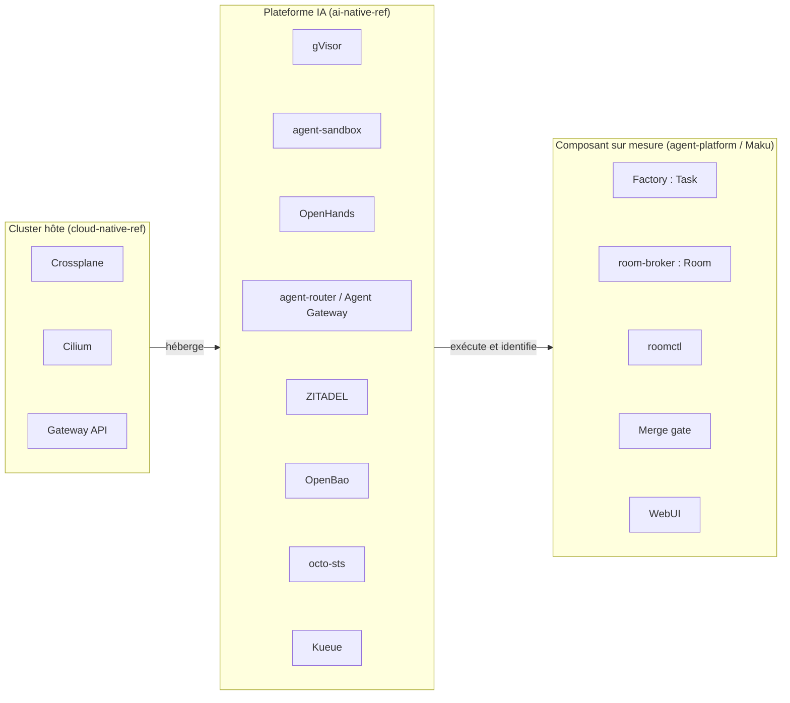
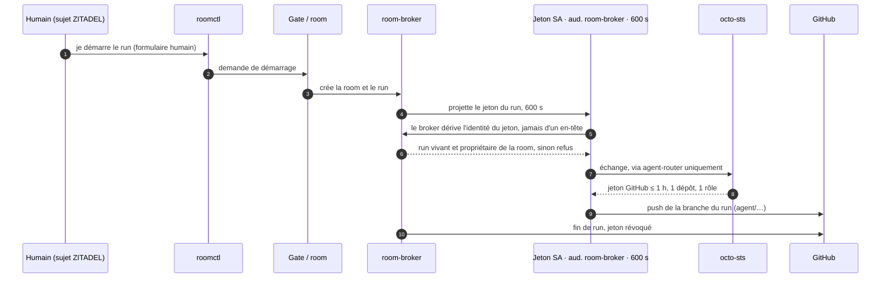
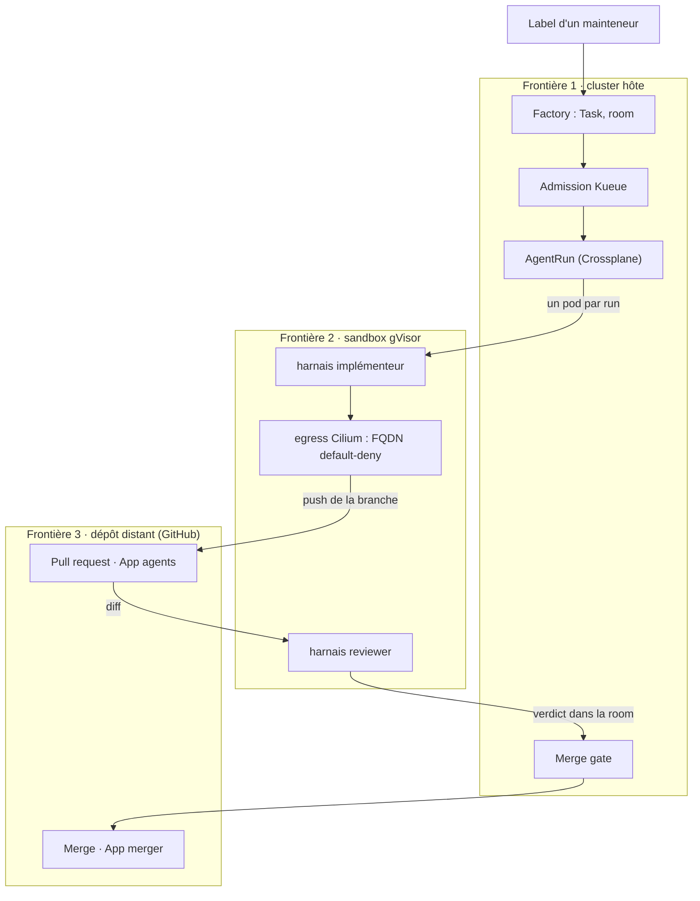

+++
author = "Smaine Kahlouch"
title = "Agent factory cloud-native : déléguer un merge sans abandonner le contrôle"
date = "2026-11-04"
summary = "De gVisor à Maku, en passant par Cilium, Kueue, ZITADEL et OpenBao : anatomie d'une agent factory cloud-native, ses chiffres datés, et ce qui ne marche pas encore."
featured = false
draft = true
codeMaxLines = 30
usePageBundles = true
toc = true
series = ["Agentic AI"]
tags = ["ai", "kubernetes", "platform-engineering", "security"]
categories = []
thumbnail = "thumbnail.png"
+++

Dex Horthy a construit une usine logicielle entièrement automatisée. Elle a tenu environ quatre mois. Elle n'est pas morte d'un bug, mais de **dette de compréhension** (*comprehension debt*, le coût de ne plus savoir pourquoi un bout de code existe, parce que plus personne n'a suivi la décision qui l'a produit). <!-- status: V -->

Le contraste avec notre plateforme est instructif. **Deux lanes** (*lanes*, des voies de livraison automatisées, une par type de changement) y tournent seules : la vérification des liens de la documentation, et un *revert* automatique qui sert de disjoncteur. Le reste est en **shadow** : les agents proposent, un humain exécute, nous comparons. Personne dans l'équipe n'appelle ça de l'autonomie. <!-- status: V -->

Ce n'est pas de la modestie, c'est de la comptabilité : une lane ne passe en production que quand ses merges concluants dépassent ce que le hasard explique. Et le plus coûteux n'a pas été le modèle — une ligne de configuration que l'on change en une minute — mais l'**identité**, l'**egress** (*egress*, le trafic sortant autorisé) et la **preuve** de ce qui s'est passé. Une machine à qui l'on confie un accès git doit être identifiable, révocable et auditable. <!-- status: W -->

La question n'est donc pas *est-ce qu'un modèle sait coder*, mais : **qu'est-ce qui doit être vrai pour qu'on délègue un merge à une machine ?**

{}
Les chiffres de cet article sont datés du **2026-10-18 au 2026-10-27** et portent leur taille d'échantillon. Le composant d'orchestration (Maku, v3) est en cours : les sections distinguent explicitement ce qui est validé, ce qui est en cours et ce qui manque. L'article sera mis à jour quand la v3 sera terminée.
{}

## 🎯 Objectifs de cet article

À la fin de cet article, vous saurez :

* distinguer une **factory of agents** (une plateforme pour construire des agents) d'une **factory run by agents** (un système de livraison piloté par des agents) ;
* nommer les **six capacités** indépendantes de la technologie : intake, isolation, identité, egress, boucle réutilisable, coût et observabilité par run ;
* traduire chacune de ces capacités en composant cloud-native, et voir ce qui reste sur mesure ;
* suivre une identité de bout en bout : un humain, plusieurs agents, un token par run ;
* parcourir deux scénarios réels : développeur backend, puis ingénieur plateforme ;
* lire des chiffres datés — coût, latence, cache — avec leur taille d'échantillon ;
* savoir ce qui manque encore, avant la conclusion ;
* repartir avec une grille de décision pour votre contexte.

## 🧠 Concepts : boucle, harnais, usine

Trois mots reviennent dans toutes les conversations sur le sujet, et ils ne désignent pas la même chose. Une **boucle** (*loop*) est le cycle par lequel un modèle observe, agit, puis observe le résultat : c'est le niveau du modèle. Un **harnais** (*harness*) est ce qui transforme cette boucle en travail utile — un sandbox, des outils, des permissions, un contexte : c'est le niveau de l'exécution. Une **usine** (*factory*) est un ensemble de boucles harnachées, une **file** (*queue*) qui les alimente et un **gate de revue** qui les filtre : c'est le niveau du système. Ces trois niveaux s'emboîtent, et la plupart des désaccords publics viennent de gens qui parlent de l'un en croyant parler de l'autre.

Cette hiérarchie vient d'Addy Osmani, et son mérite est de nommer le point qui compte vraiment : quelqu'un possède la **boucle extérieure**, celle qui écrit la spec et qui merge. Le reste — le nombre de boucles, leur parallélisme, la finesse des outils — n'est que de l'implémentation. Dan Shapiro range les organisations sur cinq niveaux, dont trois suffisent ici (un **diff** désigne la différence de code proposée dans une *pull request*, ou **PR**) :

| Niveau | Qui lit les diffs | Ce que l'humain possède |
|---|---|---|
| **L3** | un humain, chaque diff | le code |
| **L4** | un humain, les cas risqués | la spec et le gate |
| **L5**, dit *dark* | personne, diff par diff | la spec et la responsabilité du résultat |

Nous sommes en **L4** : l'humain écrit la spec et le gate, les agents construisent. Le L5 n'a pas de cas public vérifié — l'usine morte en quatre mois en est le contre-exemple le plus documenté — et l'essai contrôlé de METR (*Model Evaluation & Threat Research*, l'organisme qui l'a publié) n'a jamais trouvé d'accélération démontrée pour des développeurs expérimentés sur leur propre base de code : 19 % plus lent à l'origine, un effet atténué par la mise à jour de 2026, jamais inversé. Autrement dit, le passage au L5 ne s'achète pas avec un meilleur modèle : il faut que la qualité mesurée et la compréhension du code tiennent sans relecture humaine. Rien dans les sources publiques ne le montre aujourd'hui. <!-- status: V -->

La seconde source de confusion est le mot lui-même. En 2026, le marketing appelle *agent factory* une plateforme pour **construire** des agents ; les praticiens appellent du même mot un système de **livraison** piloté par des agents. Ce sont deux marchés différents, qui ne répondent pas à la même question — et chercher le premier quand on veut le second mène droit à une page produit. Gardez ce réflexe : si la page vend des *agents métier* prêts à l'emploi, vous êtes dans la colonne de gauche. <!-- status: V -->

Notre sujet est la colonne de droite : un système où des agents prennent une partie du travail de livraison, avec une file, des sandboxes, des identités et un gate. Et « dark » mérite une définition que nous assumerons jusqu'à la dernière section : *dark* veut dire que **personne ne lit chaque diff**, pas que personne n'est responsable. Un humain écrit la spec, arbitre les cas risqués et répond du merge ; ce qui disparaît, c'est la relecture ligne à ligne de tout ce que la machine produit. Cette nuance paraît cosmétique ; elle décide en réalité de tout le reste, parce qu'elle détermine quels contrôles doivent exister **avant** le gate pour que son absence de lecture soit défendable. C'est le fil de l'article : une **approbation** est un acte de supervision, pas une frontière de sécurité, et une frontière se construit — identité, sandbox, egress, provenance — avant que le diff n'arrive.

## 🧱 Six capacités, indépendantes de la techno

Avant de comparer des outils, il faut un vocabulaire qui ne dépende d'aucun d'eux. Une agent factory répond à six questions, et elles se posent de la même façon que vous louiez un service ou que vous montiez le vôtre. Ce filtre est utile dans les deux sens : un composant qui ne répond à aucune des six n'appartient pas à la factory — c'est un éditeur de code, un chatbot ou un script — et une capacité que personne ne nomme est presque toujours celle qui manquera au premier incident. <!-- status: V -->

| Capacité | Question à laquelle elle répond | Ce qui casse sans elle |
|---|---|---|
| **Intake** — d'où vient le travail | Quelle source décide de ce qui sera fait, dans quel ordre, avec quel plafond de dépense ? | Des runs lancés à la main : pas de file, donc pas de priorité ; pas de déduplication, donc le même ticket payé deux fois ; pas de plafond, donc une facture qui ne se discute qu'à la fin du mois. |
| **Isolation** — où le code s'exécute | Sur quoi l'agent a-t-il réellement les mains, et qu'est-ce qui l'empêche d'en sortir ? | Un contenu piégé lit les identifiants de l'hôte et les runs voisins. La sandbox n'est pas un confort de développement, c'est le seul endroit où l'on accepte d'exécuter du code non relu. |
| **Identité** — qui agit, avec quel jeton | Qui a poussé ce commit, sur quel dépôt, et comment révoque-t-on ce droit en trente secondes ? | Tout se fait sous votre compte personnel : l'audit ne distingue plus l'agent de vous, et un incident ne se révoque qu'en changeant votre mot de passe. |
| **Egress et gouvernance** — ce que l'agent peut joindre | Quelles destinations sortent, pour quelle classe de données, et qui le décide ailleurs que dans le prompt ? | Le canal de sortie devient le canal d'exfiltration, et la politique de données se résume à ce que le modèle a bien voulu respecter. |
| **Boucle réutilisable** — l'API du harnais | Peut-on relancer la même boucle sur un deuxième dépôt, ou sur un deuxième fournisseur de modèle, sans réécrire l'intégration ? | Chaque dépôt devient un fork : l'outillage se duplique, et le coût de maintenance dépasse le temps gagné sur les runs. |
| **Coût et observabilité par run** | Combien a coûté ce run précis, qu'a-t-il appelé, et à quel moment a-t-il dérivé ? | Une facture mensuelle agrégée et un incident anonyme. Élargir l'autonomie devient alors une opinion, pas une décision. |

Le **gate de revue** n'est volontairement pas dans ce tableau. Ce n'est plus un différenciateur mais le plancher : en 2026, tous les produits comparables ouvrent une branche ou une *pull request* et attendent un humain, et un agent qui merge sans gate est un incident, pas une fonctionnalité. Ce qui reste ouvert — et ce qui décide vraiment de ce que vous pourrez déléguer — tient en quatre axes : **où se situe la frontière de confiance** (auto-hébergé, API managée, VPC dédié), **si la boucle est exposée comme une API réutilisable**, **la granularité de l'identité et de la gouvernance** (par run ou par dépôt), et **le coût et l'observabilité par run**. Ces quatre axes sont une lecture de notre relevé du paysage (octobre 2026, une dizaine de produits, documentation primaire) : aucun classement ne les mesure, ils décrivent une architecture. <!-- status: V -->

## ☁️ La traduction cloud-native : qui fait quoi

Ces six capacités, il faut les loger quelque part. Chez nous, elles se répartissent sur trois couches, et la distinction n'est pas cosmétique : elle dit qui vous mettez à jour quand quelque chose casse, et à qui appartient la frontière de confiance. Le **cluster hôte** fournit l'infrastructure ; la **plateforme IA** fournit l'exécution, l'identité et la sortie réseau ; le **composant sur mesure** fournit l'orchestration, le journal et le gate. <!-- status: I -->

Le tableau ci-dessous donne, pour chaque composant, son rôle exact, le dépôt où il vit et ce que nous pouvons honnêtement affirmer de son état. **Validé** veut dire mesuré par un runbook daté ou par un run réel ; **implémenté, non mesuré** veut dire que le code est là et tourne, mais qu'aucune preuve chiffrée n'est publiable ; **en cours** veut dire partiel, encore en mouvement, donc susceptible de changer sous vos pieds ; **absent** veut dire non branché — et il vaut mieux le lire ici que le découvrir en production. La différence entre les deux états du milieu n'est pas cosmétique : un composant « implémenté, non mesuré » ne bouge plus guère, un composant « en cours » peut changer de contrat avant la publication.

| Composant | Rôle dans la factory | Dépôt | Statut |
|---|---|---|---|
| **Crossplane** | Compose l'`AgentRun` et crée la sandbox à partir d'une réclamation, sans intervention humaine | cloud-native-ref | validé <!-- status: V --> |
| **Cilium** | Maille et **egress** : refus par défaut, liste d'autorisation par nom de domaine, refus au niveau DNS | cloud-native-ref | validé <!-- status: V --> |
| **Gateway API** | Expose les interfaces internes (UI des rooms, agents) derrière la Tailscale Gateway | cloud-native-ref | validé <!-- status: V --> |
| **gVisor** | Intercepte les appels système du pod de run ; pool de nœuds dédié `agents-gvisor` | ai-native-ref | validé <!-- status: V --> |
| **agent-sandbox** | La primitive Kubernetes du pod de run : `Sandbox`, gabarit, réclamation | ai-native-ref | validé <!-- status: V --> |
| **agent-router / Agent Gateway** | Seul chemin du sandbox vers les modèles, les outils MCP et GitHub ; valide le jeton et injecte les identifiants fournisseur | ai-native-ref | validé <!-- status: V --> |
| **OpenHands** (`agent-server`, uid 10001) | Le harnais : boucle d'agent, terminal, `git`, ouverture de la PR | ai-native-ref | validé <!-- status: V --> |
| **ZITADEL** | Fournisseur d'identité des humains : OIDC, rôles de projet, groupes | ai-native-ref | validé <!-- status: V --> |
| **OpenBao** | Coffre des secrets ; un rôle par usage, un store restreint par namespace | ai-native-ref | validé <!-- status: V --> |
| **octo-sts** | Échange le jeton du run contre un jeton GitHub court, borné à un dépôt et à un rôle | ai-native-ref | validé <!-- status: V --> |
| **Kueue** | Admet les sandboxes dans des files plafonnées (factory / interactif) | ai-native-ref | implémenté, non mesuré <!-- status: I --> |
| **Factory** (`agent-factory`, CRD `Task`) | Prend une issue étiquetée, crée la room, lance les runs, mesure, narre sur l'issue | agent-platform-maku | validé <!-- status: V --> |
| **room-broker** (CRD `Room`) | Le journal de référence : il authentifie chaque écrivain, caviarde, séquence et scelle | agent-platform-maku | validé <!-- status: V --> |
| **`roomctl`** | Le client terminal des humains : regarder, poster, mettre en file, forker | agent-platform-maku | validé <!-- status: V --> |
| **Merge gate** | Lit la PR dans l'ordre, ligne par ligne, et ne merge que ce que la classe autorise | agent-platform-maku | validé <!-- status: V --> |
| **WebUI** | Carte d'approbation, file « needs-you », pilotage de la room | agent-platform-maku | validé <!-- status: V --> |
| **RunLore** | La boucle incident agent-à-agent : alerte → investigation → correctif proposé | ai-native-ref | en cours <!-- status: W --> |

Un mot sur les noms, parce qu'ils changent et que la documentation technique, elle, ne change pas encore. **Maku** est le nom produit retenu le **2026-10-27** ; tout le reste — module, binaires, images, CRD, API — reste `agent-platform` et `agent-factory` jusqu'à ce que le renommage soit fait. Quand vous lirez `agent-factory` dans un manifeste, c'est Maku. Et surtout : **Maku n'est pas la factory**, c'est le composant d'orchestration et de journal, celui de la troisième couche ; le harnais, la sandbox, l'identité et l'egress appartiennent à la plateforme, et le cluster à personne d'autre qu'au socle. Cette confusion est de loin la plus facile à commettre en lisant notre dépôt, parce que c'est celui qui porte le plus de vocabulaire produit. <!-- status: V -->

### Maku : ce que fait le composant sur mesure

Trois choses, et c'est tout. D'abord la **room** : un journal **append-only** par tâche, avec un `seq` sans trou par room, une clé d'idempotence par événement (`room_id`, client, numéro d'origine) et un **sceau** — une room scellée refuse tout ajout, y compris au niveau de la base, et ne se rouvre pas. Ensuite `roomctl`, le client terminal : il regarde, poste, met en file et forke, mais il ne pilote pas et **n'approuve jamais**. Enfin le **merge gate** : un ordre fixe de contrôles, du scan de secrets à l'identité de l'auteur, où chaque refus part vers un humain et où la dernière ligne n'est lue que si toutes les autres laisseraient merger. Le détail du gate est en section suivante ; retenez pour l'instant que c'est du code, pas une politique dans un wiki. <!-- status: V --> <!-- TODO-check: le gate de docs/factory.md (relevé 2026-10-28) liste 13 entrées — 1, 2a, 2, puis 3 à 12 — alors que le plan de l'article en fige 12 : recompter dans le code et trancher le chiffre avant de passer draft = false -->

Ce que le composant ne fait pas est aussi important. **Aucun classifieur n'est déployé** : quand l'URL du classifieur n'est pas configurée, aucun appel n'a lieu et chaque tâche prend le palier statique `standard` ; les paliers, les plafonds et les gabarits sont réels, le tri intelligent ne l'est pas <!-- status: X -->. Le modèle logique demandé reste `agent-default`. Les **budgets** par run et par tâche, en dollars, sont appliqués ; le budget par personne compte en shadow (`budget-principal-shadow`) et ne refuse qu'une fois l'option d'application activée ; le budget de flotte met le run en attente plutôt que de le refuser. <!-- status: W --> Le **scoper** (qui découpe ou questionne une issue), le **split** et le **tester** existent dans la documentation et les runbooks de preuve, avec leurs interrupteurs éteints : aucune preuve live publiée <!-- status: X -->. Le **compte machine sponsorisé** — un compte machine ZITADEL qu'un mainteneur parraine pour ouvrir du travail à sa place, avec son propre budget en dollars — est lui aussi éteint par défaut : sans entrée `api.sponsored`, la route `POST /v1/tasks` répond `404` et aucun principal machine ne crée de tâche. Le chemin est écrit et testé en runbook, pas encore prouvé live. <!-- status: W -->

{}
Trois absences à garder en tête avant de nous comparer à un produit fini : **aucun classifieur de complexité** n'est déployé (modèle statique `agent-default`, paliers et plafonds seulement) <!-- status: X --> ; les **budgets par personne et par flotte** ne refusent pas encore — ils comptent, ou mettent en attente <!-- status: W --> ; **`scoper`, `split` et `tester`** sont documentés et outillés mais sans preuve live <!-- status: X -->. Les deux lanes réellement autonomes, et le reste en shadow, sont décrits plus loin avec leurs dates.
{}

## 🔐 Sécurité de bout en bout : une identité par run

La question de sécurité d'une factory tient en une phrase : **qui agit, sous quel jeton, et jusqu'où ce jeton porte-t-il ?** Chez nous, la réponse est une chaîne de trois identités distinctes, et aucune ne se déduit d'un en-tête HTTP. Un humain (`human:`, le sujet ZITADEL) déclenche ; un run (`agent:<runId>`) exécute ; GitHub voit l'application des agents, jamais votre compte. <!-- status: V -->

Le jeton du run est un jeton de compte de service projeté, d'audience `room-broker`, valable 600 secondes, monté **uniquement** dans le conteneur du pont de room : le harnais lui-même ne le voit jamais. Le broker ne fait pas confiance à l'en-tête qui prétend désigner l'agent ; il dérive le principal du jeton vérifié hors ligne, puis exige que le run existe encore et nomme bien cette room. Côté GitHub, `octo-sts` échange ce jeton contre un accès de **une heure au plus**, limité à **un dépôt et un rôle** — un implémenteur pousse sa branche `agent/**`, un reviewer ne pousse pas du tout —, et le droit disparaît avec le run. L'application des agents ne merge jamais : seule l'application de merge du factory en a la clé, et une seule charge de travail la monte. <!-- status: V -->

Reste à voir un run entier, et ses trois frontières.

La première frontière est celle du cluster : le code des agents ne peut pas créer de run, un humain ou la boucle de mesure le fait, et l'admission passe par une file plafonnée. La deuxième est la sandbox : egress refusé par défaut, liste d'autorisation par nom de domaine, et le refus a lieu **à la résolution de nom**, pas seulement au niveau TCP — sur le round 7 de nos runbooks, le 2026-09-30 sur `gcp-0`, un nom non autorisé ne résolvait pas du tout, ce que Hubble confirme côté proxy DNS. La troisième est le dépôt distant : ce qui y entre est une branche poussée par une application, avec un diff et un verdict attachés à un run identifiable. <!-- status: V -->

L'isolation est un **spectre**, pas un label. Un conteneur ordinaire partage le noyau du nœud : bon marché, compatible, et une seule évasion d'appel système suffit. gVisor intercale un noyau utilisateur qui intercepte ces appels : la surface d'attaque se réduit au *Sentry* de gVisor, au prix de la compatibilité et d'un surcoût. Un **microVM** (Firecracker) repousse la frontière au niveau matériel ; ses auteurs annoncent un démarrage sous 125 ms pour moins de 5 Mio de surcoût — des annonces de projet, pas une mesure indépendante. Nous avons choisi gVisor parce qu'il est disponible sur les deux clouds que nous visons et que la primitive `agent-sandbox` standardise le pod ; le prix est réel : sous gVisor le profil seccomp `RuntimeDefault` n'est pas appliqué (`Seccomp: 0` dans le pod), et c'est le *Sentry* qui tient la frontière. Qui prétend que gVisor est « plus sûr » que Firecracker sans dire ce qu'il abandonne n'a pas regardé le compromis. <!-- status: V -->

Le corollaire, c'est que **les identifiants ne vivent pas dans la sandbox**. Les clés des fournisseurs de modèles n'entrent jamais dans le namespace des agents : c'est la passerelle qui valide le jeton du run et injecte l'identifiant fournisseur, ce qui veut dire qu'un agent compromis ne peut pas exfiltrer une clé qu'il n'a jamais eue. Mais la sortie elle-même reste un canal : Anthropic documente un cas d'exfiltration **par l'endpoint d'inférence autorisé**, avec une clé fournie par l'attaquant — la requête au modèle est un chemin de sortie légitime, donc utilisable. Le même article rapporte qu'une injection collée par l'utilisateur a réussi **24 fois sur 25 tentatives** (recherche Anthropic sur le confinement, publiée en 2026). Traduction pratique : un filtre de modèle ne tient pas la frontière, un contrôle d'environnement la tient. C'est exactement la **trifecta létale** de Simon Willison — données privées, contenu non fiable, communication externe : réunissez les trois dans un même run et l'injection devient une exfiltration. Notre réponse est de couper le troisième terme par défaut, jamais de demander au modèle de se méfier. <!-- status: V -->

Enfin, une approbation n'est pas une frontière : c'est de la **supervision**. Ce qu'un run peut faire est fixé **à sa création**, hors de la sandbox, par son profil, ses plafonds et son jeton. Un agent ne s'approuve pas lui-même, `roomctl` n'approuve pas du tout, et la carte d'approbation affiche l'action brute caviardée plutôt que la prose de l'agent — parce qu'un humain qui approuve du texte rédigé par le modèle approuve un récit, pas une action. Et la fatigue est mesurable : Anthropic rapporte un taux d'approbation d'environ **93 %** sur ses invites de permission, ce qui est un signal d'usure, pas une preuve de sûreté. <!-- status: V -->

{}
Quatre angles morts nommés, et ils sont dans notre propre plateforme : le confinement de l'application des agents est celui d'une **installation par dépôt**, pas d'un run <!-- status: W --> ; le profil seccomp n'est **pas appliqué sous gVisor**, la frontière est le *Sentry* <!-- status: V --> ; les journaux de GitHub ne relient pas un jeton d'agent à un run <!-- TODO-check: corroborer l'absence d'enregistrement jeton → run dans les audits GitHub avant publication --> ; et une évasion du *Sentry* atteindrait l'identité du nœud, les sandboxes voisines et les identifiants du kubelet — d'où le pool dédié, l'IMDS bridé et le recyclage quotidien des nœuds, qui réduisent l'impact sans l'annuler <!-- status: V -->.
{}

## 🧑‍💻 Scénario 1 : un développeur backend

## 🛠️ Scénario 2 : un ingénieur plateforme

## 🩺 RunLore : la boucle incident, honnêtement

## 📊 Performance, coûts et monitoring

## 💭 Dernières remarques

## 📚 Références
